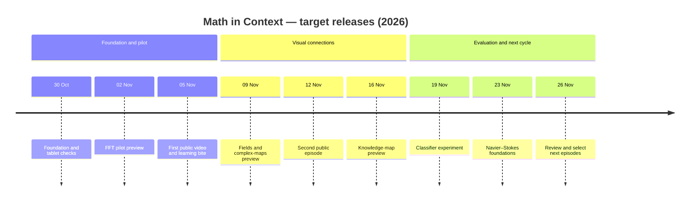

# Math in Context

Small connected explanations of mathematics, evidence and real-world use.
For curious people with university-level maths basics, not a sequential degree.

## Start here

- [First experiment: FFT and end-to-end latency](apps/fft_and_latency.py).
- [Working checklist](ROADMAP.md).
- [Concept connections](content/connections.json).
- [Source registry](content/sources.json).

Run locally: uvx marimo run apps/fft_and_latency.py

This synthetic example has no grid connection or model-key requirement.
It does not validate a new FFT algorithm or predict operator performance.

## Release timeline

Planning baseline: **29 October 2026 · Australia/Sydney**.
These are target dates, not guaranteed release dates. All milestones below are
**planned**; a date passing does not mark a release complete. Track implementation
and feedback in GitHub issues, pull requests and Actions.



| Target (2026) | Release | Deliverables and release gate |
|---|---|---|
| 30 Oct | Foundation | Merge the starter PR after review; verify GitHub Pages and test the Marimo notebook on a tablet. |
| 2 Nov | Pilot preview | FFT/latency interactive lesson, storyboard and first rendered video draft for Karin’s feedback. |
| 5 Nov | Public pilot | Reviewed 60–90-second YouTube video, Substack companion post and linked interactive exercise. |
| 9 Nov | Visual connections preview | “Same-looking curves, different physics”: complex maps, electric-field contours and magnetic dipoles, with assumptions explicit. |
| 12 Nov | Second public episode | Original visual explainer, manipulable notebook and short comprehension quiz. |
| 16 Nov | Knowledge-map preview | Browse typed relationships between problems, concepts and practical applications; no implied mathematical equivalences. |
| 19 Nov | Classifier experiment | Compare Jev, simple rules and a small model on labelled examples; adopt only if it reduces review work at acceptable accuracy and cost. |
| 23 Nov | Navier–Stokes foundations | Explain the prize question, what simulations already accomplish, and why those differ. No unreviewed research claims. |
| 26 Nov | Review and next cycle | Review learner feedback, understanding and production effort; choose the next three episodes. |

**Cadence:** aim for one polished video per week, supported by a Substack post
and Marimo activity. Twice-daily agent work advances the pipeline; it does not
promise two finished videos per day. Initial pilot dates are a trial, not a
daily publishing commitment.

**Release gates:** mathematical/source review, tested interaction, tablet usability,
legible visuals and captions, asset rights, and Karin’s approval before public
video/blog/social publication. Our research findings require independent audit
before being presented as new results. Move target dates when a gate is unmet.

## Two repositories, different jobs

[Open Notebook](https://github.com/jeunjetta/open-notebook) is the research
source-management platform. This repository is the public learning layer:
Python experiments, worked examples, feedback, scripts and source links.

Every bite names assumptions and limitations. Announcements, established
results, reproduced calculations and hypotheses are different evidence types.
Our research checkpoints need independent audit before public research claims.
Never commit credentials, private notebook exports or operator telemetry.

The original Marimo template is retained below as useful infrastructure.
Its sample notebooks are examples, not our curriculum. Pages deployment must
be verified before claiming a live URL. WebAssembly has first-load overhead
and browser dependency restrictions.

---

## Original template documentation

This template repository demonstrates how to export [marimo](https://marimo.io) notebooks to WebAssembly and deploy them to GitHub Pages.

## 📚 Included Examples

- `apps/charts.py`: Interactive data visualization with Altair
- `notebooks/fibonacci.py`: Interactive Fibonacci sequence calculator
- `notebooks/penguins.py`: Interactive data analysis with Polars and marimo

## 🚀 Usage

1. Fork this repository
2. Add your marimo files to the `notebooks/` or `apps/` directory
   1. `notebooks/` notebooks are exported with `--mode edit`
   2. `apps/` notebooks are exported with `--mode run`
3. Push to main branch
4. Go to repository **Settings > Pages** and change the "Source" dropdown to "GitHub Actions"
5. GitHub Actions will automatically build and deploy to Pages

## Including data or assets

To include data or assets in your notebooks, add them to the `public/` directory.

For example, the `apps/charts.py` notebook loads an image asset from the `public/` directory.

```markdown

```

And the `notebooks/penguins.py` notebook loads a CSV dataset from the `public/` directory.

```python
import polars as pl
df = pl.read_csv(mo.notebook_location() / "public" / "penguins.csv")
```

## 🎨 Templates

This repository includes several templates for the generated site:

1. `index.html.j2` (default): A template with styling and a footer
2. `bare.html.j2`: A minimal template with basic styling
3. `tailwind.html.j2`: A minimal and lean template using Tailwind CSS

To use a specific template, pass the `--template` parameter to the build script:

```bash
uv run .github/scripts/build.py --template templates/tailwind.html.j2
```

You can also create your own custom templates. See the [templates/README.md](templates/README.md) for more information.

## 🧪 Testing

To test the export process, run `.github/scripts/build.py` from the root directory.

```bash
uv run .github/scripts/build.py
```

This will export all notebooks in a folder called `_site/` in the root directory. Then to serve the site, run:

```bash
python -m http.server -d _site
```

This will serve the site at `http://localhost:8000`.
