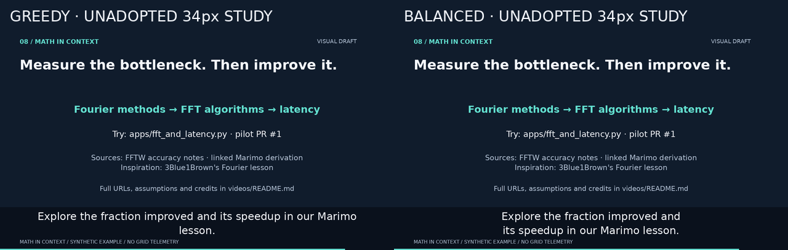

# Ending caption · remove the orphan without rewriting

17 November 2026, second video increment. **Unadopted source-frame study.**
Baseline: `3f7a74537ec0299a290deaaa9ab27292b59ad4b2`, draft PR #4.
Continues the [full-pilot layout check](CAPTION_LAYOUT.md), which found
“lesson.” alone on line two at 70–75 s. Neither panel below is the frozen
26px video: both are proposed 34px / 1120×92 caption-box source layouts.



Each panel is a 640×360 reduction of its 1280×720 source. Open at native
dimensions; viewer scaling is not a tablet or accessibility measurement.

| Layout | First-line ink width | Second-line ink width | Difference |
|---|---:|---:|---:|
| Greedy wrapping | 1,037 px | 119 px | 918 px |
| Balanced split | 582 px | 574 px | 8 px |

The selected break, with exactly the same ordered words:

> Explore the fraction improved and
> its speedup in our Marimo lesson.

`caption_balance.py` enumerates fitting word-boundary splits with at least
two words per line, minimizes absolute ink-width difference, then uses
maximum width and split index as deterministic tie-breakers. It reuses the
prior adapter's ink-bearing correction, font and box. No shorter copy,
font shrinkage, global mutation, cue retiming or production option is added.
It supports ONLY source frames 1680..1799 (70–75 s). The separate 75–80 s
caption and every other cue are outside scope, not silently rebalanced.

Inspected both full-size stills and the half-size comparison: the orphan
is absent, no caption/footer clipping seen, concept graph/source details
unchanged. The new line break puts “and” at the end of line one; equal
width is only a geometric objective, not demonstrated linguistic quality,
reading-speed improvement or comprehension. Device/editorial review remains.

Three tests render all 120 cue frames, compare changed-pixel containment,
retain exact word sequence, check ink/word-count/balance, reject outside-scope
inputs, reproduce the [report](caption-balance/report.json)/sheet and refuse
output overwrite. Source/font/image hashes are recorded. Only the sheet/
report are committed; four separate full/half-size PNGs are reproducible.

From `videos/`, choose a NEW output directory:

```sh
uv run --locked python -m unittest test_caption_balance -v
uv run --locked python caption_balance.py --out out/caption-balance-review
```

Original graphics. Official [Pillow drawing docs](https://pillow.readthedocs.io/en/stable/reference/ImageDraw.html)
and [MIT-CMU licence](https://pillow.readthedocs.io/en/stable/about.html)
checked 17 November 2026. Retain pinned 12.3.0 / lockfile and external
DejaVu Sans; no new dependency, redistributed font/encoder, third-party
asset, paid service or blanket commercial/codec-clearance claim.

Next: actual-device review of the two wrapped ending cues and the dense
49–61 s scene; select a single production treatment before encoding and
updating candidate identity. Stop adding copy/layout alternatives without a
specific defect to test. No new MP4, speech or synchronization claim; no
full-playback/accessibility or release approval. The original Marimo CTA is
still UNVERIFIED: a line-break fix does not make its destination real.
Source-only ending proposal is unadopted. Human math/editorial/rights,
audio choice, parent reconciliation, public-review-route authorization and
exact-version publication approval remain open. No sharing or publishing.
