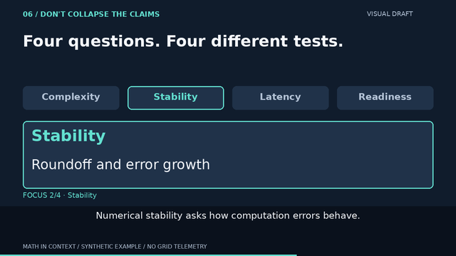
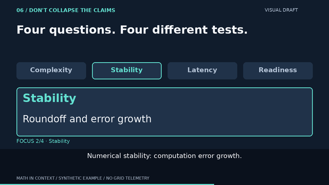

# Stability caption · one isolated fit comparison

15 November 2026. **Unadopted source-frame test, not an encoded candidate.**
This tests only the proposed 52–55 s stability caption from the
[full-pilot pacing audit](CAPTION_PACING.md). It neither adopts all four
proposals nor changes the frozen 80-second video, lesson, VTT or package.
Source baseline: `c08b87e3f63443a778eb27fc6e1ef1ab632ccb4b`.
Reference movie SHA256:
`1d3050b3094f1a090954cb9c2e6ed10e90d438169e86bd2cfbc2a7f13ed74036`.

## Same source moment, same size

Current caption, freshly rendered source frame at 52 s:



Unadopted shorter caption, same source frame and layout:



These are both SOURCE renders, not one encoded image compared with an
unencoded image. No video-compression or playback comparison is implied.

| Measured property | Current | Unadopted proposal |
|---|---|---|
| Caption | Numerical stability asks how computation errors behave. | Numerical stability: computation error growth. |
| Code points | 55 | 46 |
| Source text advance | 742.875 px | 602.0625 px |
| Lines | 1 | 1 |
| Source font / nominal at 640 width | 26 px / 13 px | 26 px / 13 px |
| Target cue hold | 3 s | 3 s |

Both actual glyph bounding boxes fit inside the source caption box; the
recorded ink bounds are in the [source/font/image report](caption-fit/report.json).
Inspected both 1280×720 source images and both 640×360 reductions. No
clipping observed. Stability remains the highlighted category; the large
“Roundoff and error growth” explanation and other context are unchanged.
There is no equation in this cue; other equation scenes were not re-reviewed.

**Finding:** shorter copy saves horizontal span, not a line or a font-size
increase. It does not by itself repair the small-caption concern or prove
that concurrent title/description/caption reading fits three seconds.
The nominal 13 px caption and 8 px footer at this half-size raster remain
small. These are raster design measurements, not CSS/device accessibility
thresholds; image viewers may scale the previews again. No comprehension,
actual-tablet or full-playback improvement is claimed.

## Isolation and reproduction

`caption_fit.py` deep-copies a freshly loaded lesson in memory and changes
only the stability caption. It does not mutate the source JSON, renderer
globals or canonical captions. Four focused tests cover that exact isolation,
actual glyph fit, all 72 frame indices 1248–1319 of the target cue, unchanged
pixels outside its caption band, deterministic still/source/image hashes,
draft identity and refusal to overwrite an existing output directory.
The frame range ends before 55 s, when the latency cue takes over.

From `videos/`:

```sh
uv run --locked python caption_fit.py --out out/new-stability-fit
uv run --locked python -m unittest test_caption_fit -v
```

Use a new output directory. It receives both states at 1280 and 640 widths
plus the report. The report records all four PNG hashes; the two reduced
previews are committed here. Full-size PNGs remain reproducible output,
not a new video or a hidden adopted candidate. All 72 source frames render
without the renderer's overflow exception; only the first pair of stills
received visual inspection. This is not decoded-frame or OCR evidence.
Exact test results: [STATUS.md](../STATUS.md).

The renderer and existing pinned Pillow 12.3.0/uv lock are retained; no new
dependency, copied creator asset, music or voice. Original project graphics;
external DejaVu font identities recorded, fonts/binaries not bundled.
Official [Pillow drawing docs](https://pillow.readthedocs.io/en/stable/reference/ImageDraw.html)
and [licensing](https://pillow.readthedocs.io/en/stable/about.html#license)
checked 15 November. Current stable documentation is 13.0.0, not a runtime
upgrade. No blanket commercial/codec/font-distribution clearance is implied.

## Next review and gates

Review the EXISTING 49–61 s scene at normal speed on the intended device,
using this pair only to judge copy. If the shorter wording is chosen,
separately decide whether type size/hierarchy also needs revision; shortening
alone has not enlarged it. Any adoption needs a controlled lesson/caption/
review/package update, rerender, encoded-cut inspection and full playback.
Do not splice these stills or silently change canonical VTT/package identity.
The synthetic 100→90 ms arithmetic, four assumptions, separation of complexity/
stability/latency/readiness and no-grid-telemetry disclaimer are untouched.
Human math/editorial/rights/device review, audio choice, ending/live-lesson
gate unless explicitly changed, parent reconciliation and exact-version
publication approval remain open. No new MP4/audio, research change, notebook,
hosting claim, browser-permission retry, publication, merge or automation.
