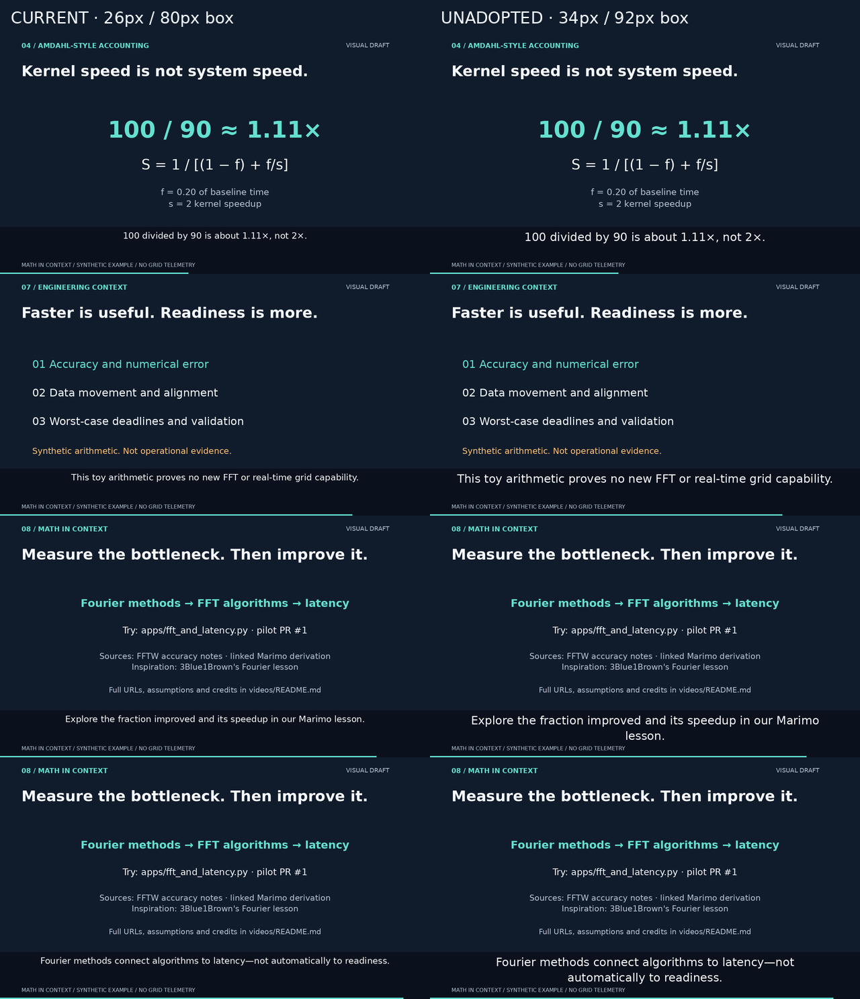

# Full-pilot larger-caption feasibility

17 November 2026. **Unadopted source layout, not a new encoded candidate.**
Baseline: `920dd609b068146e00c7f7827fc927a756e828c9`, draft PR #4.
The [category-only study](CAPTION_TYPE.md) tested four single-line captions.
This extends the check to all 19 original cues / all 1,920 source frames,
including equations, long disclaimers, source/end cards and cue boundaries.
No script, timing, frozen v7 media, VTT or release identity has changed.



Each panel is 640×360 from a 1280×720 source frame. View the image at
native dimensions; fit-to-page scaling can shrink it further. Header sizes
refer to the source canvas, not device CSS or a readability standard.

## What was established—and what failed

One consistent 34 px caption font works geometrically with a 1120×92 box
at (80,590), replacing the current 26 px / 1120×80 box only in memory.
Nominal half-size type is 17 versus 13 px. Seventeen cues use one line;
70–75 s and 75–80 s use two. Two lines cost 91.8 px of line-box height,
so simply increasing the font in the old 80 px box is NOT sufficient.
Actual glyph bounds are checked separately; lowest observed ink is
y=674.9, before the untouched footer origin y=684.

The initial advance-centered prototype failed at 65.5 s: measured advance
was 1119 px, but the first glyph's negative bearing put its left ink edge
at x=79.5, outside the x=80 box. The adapter now centers actual ink bounds,
using x_origin=x+(width-ink_width)/2-left_bearing. This cue's ink spans
exactly x=80..1200; an explicit regression assertion records the case.
No silent horizontal shrinking or clipping is allowed. Width overflow,
more than two lines or vertical ink overflow raises an error.

Visual inspection: all four proposed full-size frames at 35/65.5/70/75 s
and both columns of the half-size sheet. Equation and variable-definition
regions remain unchanged and visible in the 35 s sample. No caption/footer
overlap seen. At 70 s, greedy wrapping leaves **“lesson.” alone on line 2**;
that is an unresolved typographic weakness, not a polished ending. At 75 s,
the two-line concept-graph sentence fits but uses more vertical attention.
The footer/source details remain small. Three-second category reading load
and all other cue durations are unchanged; geometry is not comprehension.

## Inspectable implementation

- `caption-layout.json`: separate proposed style/sample configuration.
- `caption_layout.py`: measurement, actual-ink centering, isolated caption
  overlay and no-overwrite still/report export; no monkey-patched globals.
- `test_caption_layout.py`: every pilot frame, original cue/word preservation,
  ink/bearing regression, invalid inputs, report/sheet reproduction and
  output no-overwrite. Changed pixels must stay inside x=80..1200,
  y=590..682. Hero graphics, equations, footer and progress are untouched.
- [report.json](caption-layout/report.json): all 19 cue line breaks, ink
  bounds/origins, source/font/image identities. Eight full-size stills are
  reproducible; only the sheet/report are checked in.

Reproduce from `videos/`, with a NEW output directory:

```sh
uv run --locked python -m unittest test_caption_layout -v
uv run --locked python caption_layout.py --out out/caption-layout-review
```

Original graphics; no footage, voice, telemetry, private notebook or private
review-file link. Pinned Pillow 12.3.0 and external DejaVu Sans retained.
Official [drawing docs](https://pillow.readthedocs.io/en/stable/reference/ImageDraw.html)
and [MIT-CMU licence](https://pillow.readthedocs.io/en/stable/about.html)
checked 17 November 2026; no dependency/lock change, bundled font/encoder,
paid service or blanket commercial/codec clearance claim.

Next bounded implementation, if continuing without an adoption decision:
test a word-preserving balanced two-line break for the 70–75 s cue, with
the same font/box, rather than adding another shorter-copy variant. Then
inspect both wrapped cues on an actual device before selecting a production
treatment and encoding. Do not promote this source-fit report to motion,
encoded legibility, full-playback, speech-sync or accessibility approval.
The existing live-Marimo CTA remains unverified and unchanged; source-only
ending alternative is unadopted. Audio choice, human math/editorial/rights,
device and exact-version release approval, public-review-route authorization
and stacked-parent reconciliation remain open. No publishing or merge.
