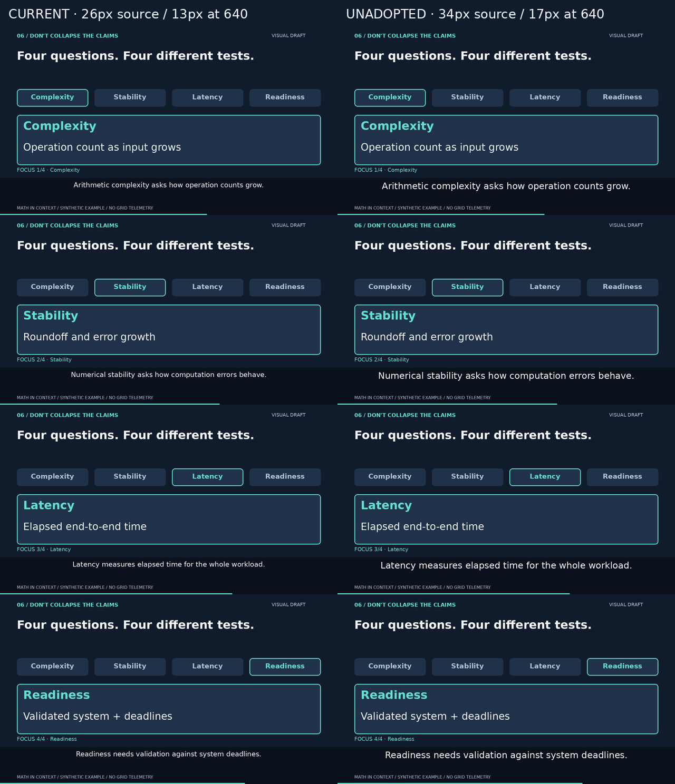

# Category captions · original wording, larger type

16 November 2026. **Unadopted source-frame study, not an encoded candidate.**
Source baseline: `1538d57e3128d75767af52c2a7e022023b2c03ea` on draft PR #4.
The frozen full v7 movie, script, VTT, packaging and release gates are unchanged.

The [previous copy study](CAPTION_FIT.md) shortened the stability caption but
left its size unchanged. This study asks a different, narrow question:
can the four ORIGINAL category captions fit at 34 px instead of 26 px,
without changing copy, timing, the hero explanation or the caption box?



Each panel is a 640×360 reduction of its 1280×720 source frame. Open the
image at native dimensions; fit-to-page viewers may shrink it further.

| Cue | Current advance at 26 px | Study advance at 34 px | Study line count |
|---|---:|---:|---:|
| Complexity, 49–52 s | 721.11 px | 943.05 px | 1 |
| Numerical stability, 52–55 s | 742.88 px | 971.48 px | 1 |
| Latency, 55–58 s | 730.08 px | 954.73 px | 1 |
| Readiness, 58–61 s | 703.47 px | 919.95 px | 1 |

Result: all fit the existing 1120×80 source caption box. Nominal type size
grows 30.8%, from 13 to 17 px at half-size. Actual source ink bounds are
also checked, not inferred from font size; all four study bounds stay within
the box. Neither nominal size nor fit establishes an accessibility threshold.
Observed in full-size study frames and this eight-panel half-size sheet:
no caption clipping, unchanged active category/description, and a larger
caption relative to the context-strip labels. The footer and context labels
remain small; the sentence still competes with the active explanation.

`caption_type_study.py` renders through the frozen renderer, then replaces
ONLY the caption-box pixels in memory for frames 1176..1463. It refuses other
frames/sizes and any caption needing a wrap. This is an experiment adapter,
not a production renderer option; there is no global patch or data mutation.
Tests render all 288 study frames, check changed-pixel containment, original
26px pixel identity, incoming/outgoing cues, exact original wording, invalid
inputs, deterministic sheet/report reproduction and output no-overwrite.
The [report](caption-type/report.json) records source/font/image hashes.

Reproduce from `videos/`, using a NEW output directory:

```sh
uv run --locked python -m unittest test_caption_type_study -v
uv run --locked python caption_type_study.py --out out/caption-type-review
```

This exports eight full-size PNGs, the comparison sheet and report. Only the
sheet/report are checked in. Original code-generated graphics and external
DejaVu Sans; no third-party footage, voice, telemetry or private review links.
Pinned Pillow 12.3.0 / lockfile retained. Official [drawing documentation](https://pillow.readthedocs.io/en/stable/reference/ImageDraw.html)
and [MIT-CMU licence](https://pillow.readthedocs.io/en/stable/about.html)
checked 16 November 2026; no dependency, encoder, font-distribution or paid
service change, and no blanket commercial/codec clearance claimed.

Next decision: compare original wording at larger type against the separate
short-copy option on an actual viewing device. If selected, make an explicit
production layout change, review the 48–49 / 61–62 s type-size transitions,
and encode/review the result before changing candidate identity. Do not apply
34px globally: other captions and equation scenes have not been tested here.
No evidence yet for three-second comprehension, motion, encoded legibility,
full playback, tablet accessibility or speech sync. No audio exists. The live
lesson/CTA, audio choice, human editorial/math/rights and exact-version release
approvals remain open. Open Notebook deployment is not assumed.
