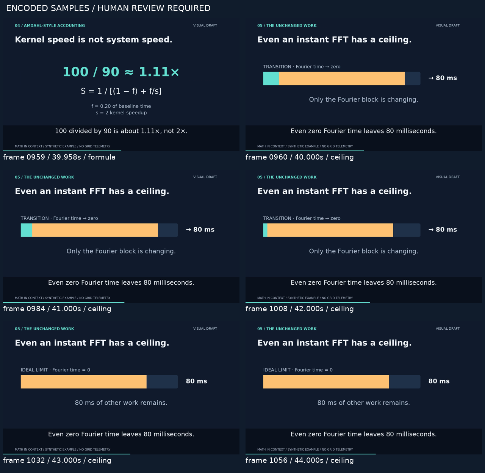

# Dense encoded-frame QA recovered

19 November 2026. Source baseline: `62e288b77e1524c08d38a4e81e2c8a2df380801a`.
**Technical QA increment, not a movie edit or release approval.**

The [existing 80-second caption-layout review](CAPTION_REVIEW_RENDER.md)
previously exported only 39 cut/midpoint samples after its denser filter failed.
This run recovered the intended 101-sample selection: every whole second,
both sides of every caption cut, scene midpoints, first and last frames.
This does not substitute for the [one-copy playback review](PLAYBACK_REVIEW.md).

## Reproduced failure and bounded fix

On external FFmpeg `7.1.5-0+deb13u1`, the original flat sum of 101 frame
comparisons (1,153 characters) reproducibly fails with exit 244 and
`Cannot allocate memory` during filter initialization. The SAME comparisons
grouped as a balanced binary sum (1,353 characters) succeed. No selected
index is omitted, no interval is widened and no false success is substituted.
This demonstrates an expression-structure-sensitive failure in this build;
it does not independently diagnose the exact allocator/parser limit or
establish a general RAM shortage. No encoder upgrade or permission change.

`dense_qa.py` supplies a separate opt-in path for this exact review movie.
It checks the input against the existing render identity, reuses frozen
`qa.py` for media/all-timestamp/full-stream-decode checks and the 39-sample
pack, then performs a second full decode with the balanced selection.
It checks output count, creates contact sheets with existing components,
and writes success only after completion and a final input-hash check.
No monkeypatching, new dependencies or edits to archived QA/render code.
An existing output directory is refused; incomplete exports may remain
after failure, but no successful final report is written for them.

From `videos/`, use a NEW output directory and the exact supplied local MP4:

```sh
uv run --locked python -m unittest test_dense_qa -v
uv run --locked python dense_qa.py /absolute/path/fft-caption-layout-review.mp4 --out out/dense-review
```

The tool deliberately rejects frozen v7, either teaser, and any differently
encoded movie. It does not fetch a file, rerender it or grant publication.

## Exact evidence and visual inspection

Input SHA-256 remains
`d0b22d6291d0b8d9205bd5e47d7d27cbd8892f63df4a1957a7d3d5decc605142`.
80.0 s, 1,920 frames, 24 fps, 1280×720 H.264, no audio. All timestamps
and both complete decode passes succeed. The [report](dense-qa/report.json)
records the input/source hashes, exact selection, 101 image hashes, expected
caption metadata and 17 contact-sheet names. Full images and the nested
39-sample baseline pack are reproducible under ignored `out/`.

Independent executed selection check on THIS movie: all 101 selected PTS/
pixel-MD5 pairs equal the indexed records from a full 1,920-frame decode;
all 39 shared PNG SHA-256 pairs equal the nested baseline pack. MD5 is used
only for decoder pixel comparison, not provenance/security identity.
The expected captions in the report remain metadata, not OCR verification.

Inspected contact sheets 04, 05, 09 and 12, plus native-size frames 1068
(44.5 s equation) and 1919 (last frame). The new 19/20 s and 41/42 s samples
show the labelled transition arrows before the settled 90/80 ms totals.
No caption/footer clipping seen in these inspected samples; 1.25× appears
with the 44.5 s cue, and the final wrapped caption is present at frame 1919.
Not all 101 images received visual review; no normal-speed motion, stutter,
comprehension, full-size/device/accessibility or speech-sync approval.



This original QA sheet SHA-256 is
`2343e547e6b53e5fb25e85e7f6623ae24b6b87f0f7ad40035553d8640d225e15`.
It is a review aid, not newly generated operational telemetry or footage.

Four new tests cover validated indices, no-overwrite/identity guards,
failure without success reporting and actual FFmpeg selection of 101 known
frames (timestamps and pixel hashes checked against a 128-frame synthetic
fixture). Full Python suite: **139 pass in 86.954 s**. Review HTML,
caption-pacing/narration source-copy and whitespace checks pass. Earlier
source/identity records remain intact, not rewritten to match new code.

Official [select filter docs](https://ffmpeg.org/ffmpeg-filters.html#select_002c-aselect),
[expression docs](https://ffmpeg.org/ffmpeg-utils.html#Expression-Evaluation)
and [legal page](https://ffmpeg.org/legal.html) checked 19 November 2026.
Existing Python/Pillow 12.3.0 / lockfile, external DejaVu and external GPL-enabled
FFmpeg retained; no bundled binary/font, new renderer selection, paid service,
third-party creator assets or blanket commercial/codec-clearance claim.

Next: use the existing exact-copy sheet for one complete intended-device
normal-speed review; no additional variants absent a specific observed defect.
Still open: usable full-size native/tablet playback; human math/editorial/rights
review; audio choice and retiming if needed; verified live-Marimo destination
or explicit fallback adoption; authorized review route; stacked-parent
reconciliation; exact-version release approval. This fixes the dense export
failure only. It does not fix the small native-monitor limitation, deploy
Open Notebook/Marimo, adopt the layout or publish anything.
