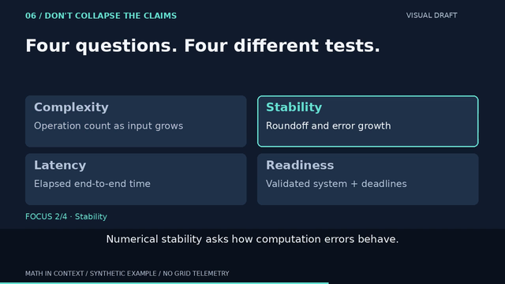
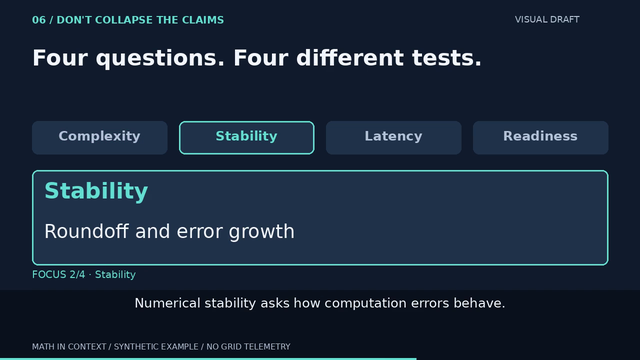

# v7 · focus-first category candidate

4 November 2026. **Silent visual candidate, not an approved release.**
Responds to the density concern in [the v6 audit](SMALL_SCREEN.md), without
changing lesson copy, the 100→90 ms model, captions, audio or duration.
Base source: `ad0d35aced7ff2a5e33cc08f128896b0b7604e57` on PR #2.

## Same encoded moment, smaller view

v6, 52 s — four descriptions compete with the current caption:



v7 candidate, 52 s — all category titles persist; only the active description:



The source description font grows from 24 to 38 px (nominally 12→19 px in
this half-size raster). The active title grows from 30 to 44 px (15→22 px).
The context-strip titles are smaller: 26 px (13 px at half size). That is an
explicit tradeoff: larger current explanation, less space for inactive context.
These are nominal raster sizes, not CSS sizes, glyph heights or accessibility
thresholds. Image viewers may scale the previews again.

Observed in the inspected samples: current title, explanation, highlighted tab
and caption agree; no visible clipping. Three inactive descriptions are removed,
not merely dimmed. The category order and full lesson wording remain intact.
Larger text and fewer simultaneous descriptions are verifiable; improved
comprehension or adequate three-second pacing is **not yet established**.

## Timing and implementation

| Interval | Highlight and enlarged description |
|---|---|
| 49–52 s | Complexity · Operation count as input grows |
| 52–55 s | Stability · Roundoff and error growth |
| 55–58 s | Latency · Elapsed end-to-end time |
| 58–61 s | Readiness · Validated system + deadlines |

Incoming cues own the boundary. `cue_at()` drives the context-strip outline,
hero title/description, focus label and existing burned caption; no extra clock.
`focus_cards()` is the reusable drawing component; lesson copy stays in JSON.
Only the distinctions branch of the scene renderer calls it.

## Actual verification and provenance

- 32 tests pass in 25.500 s: all 3,840 frame-fit checks across two synthetic
  fixtures; existing arithmetic, cue/VTT, transition, QA and packaging checks;
  updated focus-border pixels; new active-description-only/font-size assertions
  at each incoming and last outgoing frame. No cue or canonical VTT changes.
- Full v7 render: H.264 1280×720, 24 fps, 1,920 verified timestamps,
  80.000 seconds, no audio; complete decode succeeds. QA exports 101 samples.
- Inspected full-size encoded 49/52/55/58 s frames, contact sheets 09–14
  covering the lead-in, all category cuts and exit, plus v6/v7 640-wide 52 s
  comparison. This is sampled QA, **not full human playback or a tablet test**.
- MP4: 669,380 bytes, SHA256
  `1d3050b3094f1a090954cb9c2e6ed10e90d438169e86bd2cfbc2a7f13ed74036`.
- Committed v7 preview: decoded frame 1248, QA `frames/0066.png`, resized
  using existing `small_screen.py` (Pillow LANCZOS); PNG SHA256
  `875cc831d6cddcb4b0968aa7c11251c7e756fb755fcc60aaa47d95c2a44c7690`.
- Existing private review copy updated, retaining v6 in version history.
  No public video upload or approval. MP4 and full QA pack stay ignored in git.

Reproduce from `videos/`, with new output directories:

```sh
uv run --locked python -m unittest test_video test_qa test_thumbnail test_small_screen -v
uv run --locked python render.py --out out/v7-focus
uv run --locked python qa.py out/v7-focus/fft-latency-draft.mp4 --out out/qa-v7-focus --every-seconds 1
uv run --locked python small_screen.py out/qa-v7-focus/report.json --out out/small-v7
```

The shown preview is `out/small-v7/52s-distinctions-640.png`; its exported
manifest records report/source/output hashes. Reproduction on another encoder
or font build need not produce identical bytes. No dependency/lockfile or asset
license change. Original visuals only. Official [Pillow drawing docs](https://pillow.readthedocs.io/en/stable/reference/ImageDraw.html)
and [MIT-CMU license](https://pillow.readthedocs.io/en/stable/about.html) rechecked
4 November; pinned 12.3.0 retained, current documentation is 13.0.0.

Next: normal-speed v7 review, especially whether context-strip scanning plus
caption reading fits each three-second cue. If continuing without feedback,
audit the final title/description/source-card package against the exact render
and retained synthetic assumptions; do not retime or add narration by default.
Remaining release blockers: tablet/editorial/exact-version approval, audio
decision (retiming if recorded), verified lesson destination and final CTA links.
No operational grid, new FFT, research-solution or Open Notebook hosting claim.
