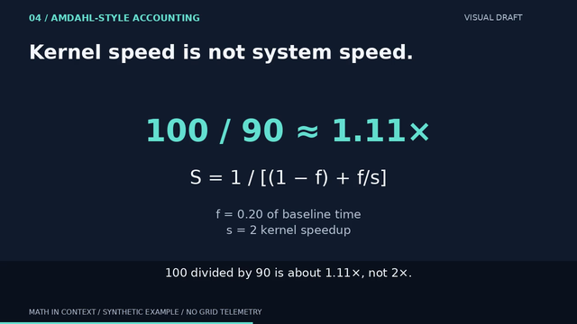
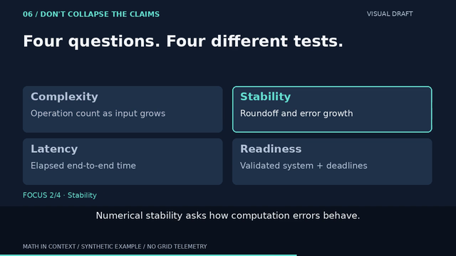
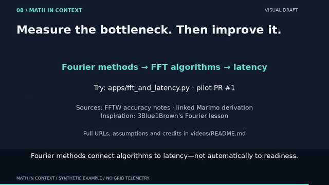

# v6 · smaller-view review pack

3 November 2026. **Sampled visual inspection, not actual-tablet testing or
release approval.** The video has not been retimed or rerendered for this pack.

## Exact draft and method

Video source: `7997d44991a32f20d9365d6d3f3ad9b99cc73bb0` on PR #2.
Encoded input SHA256:
`2d3a2b0976951c88292229eaebbc6e6a92c4322c2714e09463055f82bead14c9`.
Fresh QA of that existing file completed: H.264, 1280×720, 24 fps,
1,920 verified timestamps, 80.000 seconds, no audio; 101 samples decoded.

Selected encoded frames: 840 (35 s, formula), 1248 (52 s, incoming stability
cue) and 1800 (75 s, end/source card). Each full decoded PNG was resized to
640×360 and 960×540 with Pillow LANCZOS, without cropping or rewriting text.
All six outputs were visually inspected. The checked-in
[manifest](small-screen-v6/manifest.json) records input/report/generator and
source/output image hashes. Hashes identify supplied files; they do not by
themselves prove extraction provenance or verify text by OCR.

These are **raster dimensions**, not measured CSS viewports, device pixels,
viewing distance or visual-acuity tests. GitHub and image viewers may rescale
them again. Open the files directly at 100% for a useful comparison; a real
device/playback test is still required. Still images cannot test three-second
card pacing, animation, understanding or audio/caption synchronization.

## Timestamped findings

### 35 s · worked equation and general formula



[960×540 comparison](small-screen-v6/35s-formula-960.png)

Observed: the numerical result `100 / 90 ≈ 1.11×` and general formula remain
visually distinct and uncut at both sizes. Parentheses, fraction slash and
approximation sign remain distinguishable in these samples. The smaller
two-line definition of f and s requires closer reading at 640. This is a
readability risk, not an observed mathematical error or a comprehension pass.

Disposition: no formula change justified by clipping; test whether the viewer
can read f and s during the 30–40 s hold in normal playback before adding copy.

### 52 s · four questions, stability in focus



[960×540 comparison](small-screen-v6/52s-distinctions-960.png)

Observed: the stability title, outline and `FOCUS 2/4` label agree with the
caption. Labels do not rely on color alone. No card or caption clipping is
visible. At 640, all four descriptions remain on screen at approximately
12-pixel nominal type while a separate caption must also be read. The focus
outline helps locate the current card, but does not remove that competing copy.
At 960 the descriptions are larger; adequate reading time is still untested.

Disposition: highest-priority next visual candidate is **focus-first cards**:
retain all four category titles as context, but enlarge/show only the active
description. Keep the existing lesson and cue semantics. Compare this candidate
against v6 rather than treating it as an approved improvement from stills alone.

### 75 s · concept placement and source/end card



[960×540 comparison](small-screen-v6/75s-end-960.png)

Observed: the concept chain and large heading remain distinct; no clipping
visible. Source credits and the README pointer are notably smaller than the
concept chain, especially at 640. The repo path is a draft handoff, not a usable
viewer-facing lesson URL. There is still no verified deployed lesson link.

Disposition: retain full clickable citations in the description/companion
page. Replace the draft CTA only when a live destination is verified; then
review the end card again. A scaled still cannot clear that release blocker.

## Exact nominal size comparison

Sizes below are renderer font size × raster scale, **not measured glyph height,
CSS text size or an accessibility threshold**. They explain the density concern.

| Element | 1280-wide source | 640-wide preview | 960-wide preview |
|---|---:|---:|---:|
| Worked numerical equation | 68 px | 34 px | 51 px |
| General formula | 42 px | 21 px | 31.5 px |
| f/s definitions and main captions | 26 px | 13 px | 19.5 px |
| Card titles | 30 px | 15 px | 22.5 px |
| Card descriptions and source credits | 24 px | 12 px | 18 px |
| README source pointer | 22 px | 11 px | 16.5 px |
| Synthetic/no-telemetry footer | 16 px | 8 px | 12 px |

The footer is not a substitute for the explicit synthetic assumptions and
non-operational scope in the lesson, captions and companion description.

## Reproduce and validate

From `videos/`, using the matching v6 MP4 and **new** output directories:

```sh
uv run --locked python qa.py PATH_TO_V6.mp4 --out out/qa-small-screen --every-seconds 1
uv run --locked python small_screen.py out/qa-small-screen/report.json --out out/small-screen-v6
uv run --locked python -m unittest test_video test_qa test_thumbnail test_small_screen -v
```

`small_screen.py` checks the expected pilot geometry/timing and supplied QA
flags, exact sample positions and full-size source geometry before exporting.
It rejects duplicate/missing samples, path escapes and existing output folders.
It does not decode the MP4 itself, inspect OCR, approve a device or certify a QA
report's assertions. Use `qa.py` first on the file being reviewed.

Actual validation: **31 tests pass in 25.986 s** on the final rerun, including all 3,840-frame
text-fit checks across both lesson fixtures and four new pack tests covering
dimensions, source/output hashes, no-overwrite and invalid-input guards.
This increment changes no scene, caption, dependency, license or research claim.
No new audio or MP4 was produced. Normal-speed playback, actual-tablet review
and publication approval remain outstanding.

Primary implementation reference checked 3 November 2026:
[Pillow Image.resize](https://pillow.readthedocs.io/en/stable/reference/Image.html#PIL.Image.Image.resize).
Existing pinned Pillow 12.3.0 and [MIT-CMU licensing note](https://pillow.readthedocs.io/en/stable/about.html)
retained; current documentation is 13.0.0. All sampled artwork remains original
project output; no third-party footage, fonts or audio are added to this pack.
