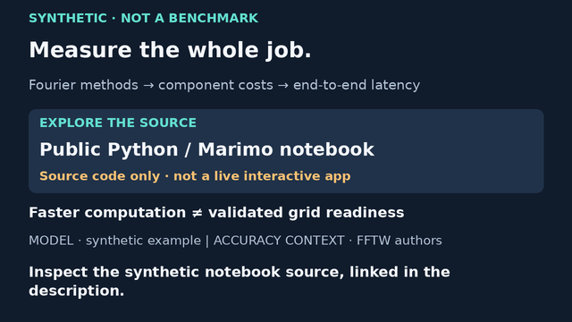
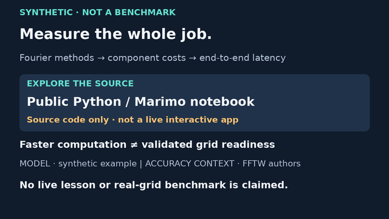

# Full FFT pilot · source-only ending proposal

13 November 2026. **Unadopted source-frame proposal, not a new video.**
This offers a truthful source-only alternative to the full pilot's current
70–80 s live-lesson-dependent call to action. It does not clear the existing
release gate, alter the frozen v7 movie, claim a deployed app, or change the
project's preference for a reviewed interactive Marimo activity.

## Preview and script





| Proposed offset in the full pilot | Reading caption |
|---|---|
| 70–75 s | Inspect the synthetic notebook source, linked in the description. |
| 75–80 s | No live lesson or real-grid benchmark is claimed. |

Both states retain the original concept placement: Fourier methods → component
costs → end-to-end latency. A source link is not an interactive learning
destination. The card explicitly says **source code only · not a live
interactive app**. Its readiness caveat is separate from the action prompt.
The earlier 100→90 ms arithmetic and all four assumptions remain unchanged
in the frozen full lesson; this card proposes no new performance claim.

## Proposed description links, only if this route is approved

- [Synthetic Python/Marimo notebook source](https://github.com/jeunjetta/math-in-context-/blob/7905dc2b30ad9c05436f4db4a03d9cfe34224ffc/apps/fft_and_latency.py): public code at the stated commit, **not** a hosted interactive app. Local use requires a suitable Python/Marimo environment; device compatibility is not established by opening the source page.
- [FFTW authors' accuracy context](https://fftw.org/accuracy/comments.html): background on numerical error, not evidence that this hypothetical timing model is a measured FFT or real-grid speedup.

Notebook source was fetched fresh on 13 November at immutable commit
`7905dc2b30ad9c05436f4db4a03d9cfe34224ffc`; returned Git blob SHA
`bf6eb0d52cb3bb20f0ec2747a0648612eb1af09a`. It contains the synthetic
formula, sliders and prediction feedback. That establishes available source,
not deployment, tablet interaction, current compliance or operational utility.
No public video destination, guessed Pages URL or Open Notebook app is inserted.

This is an alternative release design requiring a decision, NOT silent removal
of the live-lesson blocker. [LESSON_LINK.md](LESSON_LINK.md) remains the dated
deployment handoff; [REVIEW.md](REVIEW.md), existing description placeholder,
canonical captions and source/movie identities are untouched. No publication
package currently claims this proposal was adopted.

## Actual validation and reproduction

Source baseline: `368ddab0d0f3cbb4388e5d0b6784add5a92f0a83`.
Bound to existing full pilot SHA256
`1d3050b3094f1a090954cb9c2e6ed10e90d438169e86bd2cfbc2a7f13ed74036`.
Separate [copy/lesson identity](source-endcard.json), [source/font/image report](source-endcard/report.json),
full-size [first](source-endcard/phase-0-1280.png) and
[second](source-endcard/phase-1-1280.png) states make extension inspectable.
All visuals are original code graphics. Fonts stay external; no creator
footage, music, logo, narration or distinctive assets were copied.

From videos/:

```sh
uv sync --locked
uv run --locked python fft_source_endcard.py --out out/source-ending-new
uv run --locked python -m unittest test_fft_source_endcard -v
```

The destination must not already exist. Four focused tests pass: all 240
proposed frame indices/half-open cue cuts, both actual-glyph box fits,
source-only/frozen-pilot identity, generated image/source hashes and
no-overwrite guard. The 240 frame indices map to two static still states;
this is not an encoded-frame test. Minimum source font is 28 px (14 px at
640 width), a design choice rather than device-readability certification.
Both full-size and both 640-wide stills were inspected; no clipping found.
Small secondary credits and competing reading load still need human/tablet
judgement. The final full-suite result is recorded in [STATUS.md](../STATUS.md).

No new MP4, audio, encoded review, speech timing, browser test, live-lesson
interaction or approval. The review tool's previously observed browser-launch
permission restriction was not retried or bypassed. Rendering these local
stills is unaffected. No new dependency: pinned Pillow 12.3.0/uv lock retained.
[Official drawing docs](https://pillow.readthedocs.io/en/stable/reference/ImageDraw.html),
[Pillow licensing](https://pillow.readthedocs.io/en/stable/about.html#license),
FFTW context and system DejaVu notice checked 13 November. Current stable
Pillow docs describe 13.0.0, not the retained runtime. No blanket commercial
rights, binary/font-distribution or codec clearance is implied.

## Next bounded step / gates

Choose between (a) retaining the interactive-lesson release dependency and
(b) approving a source-only release design. If (b), update the complete 80 s
candidate, canonical captions, exact-version review/description/package hashes
together on a reviewed branch, rerender, inspect encoded cuts/end and full
playback, and obtain approval. Do not overwrite the frozen candidate or infer
approval from these tests. Until that choice, this is a concrete fallback,
not a silently activated replacement. Independent editorial/math/rights,
actual-device and audio decisions, parent reconciliation and explicit
exact-version publication approval still apply. No research conclusions,
notebooks, account settings, hosting, publishing or automations changed.
