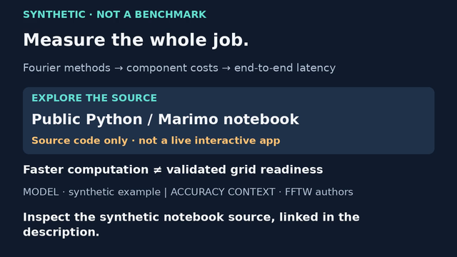
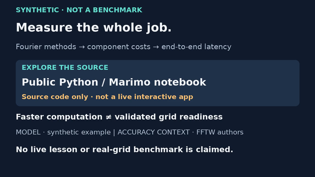

# Source-only ending · separate encoded test

13 November 2026. **Silent, unadopted 10-second technical excerpt.**
This renders the existing [source-only proposal](SOURCE_ENDCARD.md), not a new
full FFT lesson. It does not splice into or replace the frozen 80-second v7
movie, canonical captions, review identity or publication package. The live
lesson release dependency is unchanged. No deployment, grid telemetry or
operational claim is added.

[Watch the exact draft](https://chatgpt.com/library?file_id=libfile_a2459d2512648191a7db2d85689143e9&account_id=personal).
MP4 SHA256: `c6735b9bc729204db6c6238ecda204d22643489807a918dee92c8115eee65f79`.
Do not treat this excerpt as a complete educational video: the 100→90 ms
calculation and four distinctions are taught earlier in the existing pilot.

## Timing and inspected encoded frames

| Excerpt | Intended full-pilot offset | Burned-in reading caption |
|---|---|---|
| 0–5 s | 70–75 s | Inspect the synthetic notebook source, linked in the description. |
| 5–10 s | 75–80 s | No live lesson or real-grid benchmark is claimed. |

Windows are half-open: frame 119 is the old caption, frame 120 the new one.
The final frame is 239 at 9.958333 s; the stream ends at 10.000 s. Two static
visual states are intentional; there is no animation or synthetic narration.
The [matching VTT](source-ending-excerpt/fft-source-ending-excerpt.vtt) uses
excerpt-relative times, not the full pilot's 70-second offset. It duplicates
the reading captions, not an audio transcript or audio-sync certification.





Inspected decoded frames 0, 119, 120 and 239 at full size, and 119, 120 and
239 at 640×360. The captions switch correctly; no clipping observed in those
samples. The persistent concept path, source-only disclosure, synthetic label,
readiness limitation and source credit remain visible. There is no equation
on this card; equation legibility elsewhere in the frozen pilot was not
re-reviewed by this test. Ten decoded samples are generated in total.

**Editorial concern remains:** multiple persistent lines compete with the
changing caption. Minimum 28 px source type becomes 14 px at 640 width.
Technical fit is not evidence that an audience can read the whole card in ten
seconds. Actual-device, continuous human playback and comprehension review
are outstanding; simplify the hierarchy if that review finds reading overload.

## Reproduction and evidence

Fresh source baseline: `879cf7b13eb9a4cb4af3889803e41da26d31e869` on
`codex/video-teaser-pacing`, draft PR #4. Reuses original graphics and the
existing Pillow renderer/FFmpeg helper; no new dependency or lockfile change.
Content remains in `source-endcard.json`; the new wrapper only offsets its
two cue windows, encodes and validates this separate test.

From `videos/`, with external FFmpeg/ffprobe on PATH:

```sh
uv sync --locked
uv run --locked python fft_source_endcard_media.py --out out/source-ending-new
uv run --locked python -m unittest test_fft_source_endcard_media -v
uv run --locked python -m unittest discover -p 'test_*.py'
```

Output must be a new directory. It contains MP4, VTT, encoded samples at
1280/640 widths and [the recorded report](source-ending-excerpt/render-report.json).
The report binds source/font/lockfile/caption hashes, baseline and unchanged
full-pilot identity. It records H.264, 1280×720, 24 fps, 240 frames, no audio,
complete decode and all 240 expected zero-based timestamps. Four focused tests
pass (0.071 s): all frame/cue mappings, matching VTT, stored evidence hashes,
and no-overwrite guard. Full-suite result is in [STATUS.md](../STATUS.md).
Stored evidence regression checks do not rerender or independently OCR the MP4.

Retained pinned Pillow 12.3.0 and external DejaVu fonts; no binary/font bundle.
System encode tools: FFmpeg/ffprobe 7.1.5-0+deb13u1, GPL-enabled libx264 build.
Official [encoding](https://ffmpeg.org/ffmpeg.html),
[probing](https://ffmpeg.org/ffprobe.html) and
[licensing](https://ffmpeg.org/legal.html) documentation inspected 13 November.
GPL-enabled components affect the applicable FFmpeg licence; software licensing
does not by itself settle codec patent/distribution or commercial rights.
No blanket commercial clearance, paid service or copied creator assets.
See the preceding proposal for source and artwork provenance.

## Next action and exact gates

Review this exact excerpt on the intended device for simultaneous reading
load, and decide whether a source-only release route is acceptable or the
interactive-lesson gate should remain. Adoption, if approved, needs a separate
controlled full-80-second candidate/caption/review/package update and fresh
encoded/full-playback review; do not silently splice this into v7. Human
math/editorial/rights approval, audio choice, parent-PR reconciliation and
explicit exact-version publication approval remain open. Earlier optional
browser review permission restriction was not retried or bypassed. Local
encoding was available. No research, notebooks, settings, hosting, merge,
publication or automation changed.
