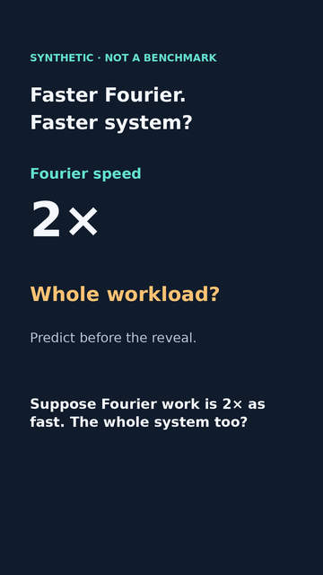
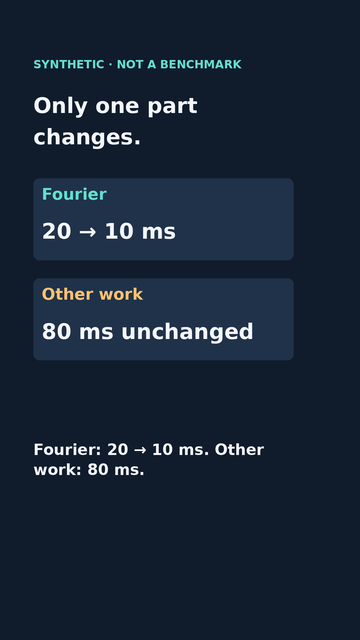
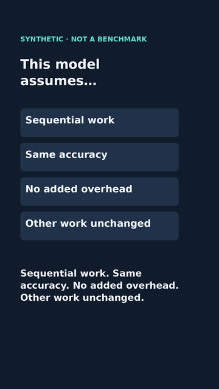
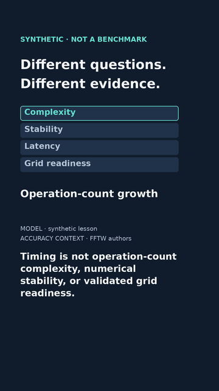

# FFT teaser · complete source-frame layouts

10 November 2026 · draft, **not a movie or an approved release**.
Source commit `c4cbdd55621cc26d7bcc6637393b5d32be882fd0` on PR #3.
The main 80-second FFT v7 explainer remains the first release milestone.

The four missing layouts now complement the unchanged baseline/result
keyframes. The new frame dispatcher covers all 672 proposed source frames
at 1080×1920, 24 fps and 28 seconds. The final six seconds highlight
complexity, stability, latency and grid readiness in turn, one description
at a time. These are designed times, not measured reading/comprehension
results. No MP4, encoder, audio track or audio-alignment claim is added.

## Review the new layouts

| Question · 0–4 s | Change one component · 8–12 s |
|---|---|
|  |  |

| Four assumptions · 17–22 s | Evidence distinctions · 22–28 s |
|---|---|
|  |  |

The other closing phases: [stability](teaser-layouts/scope-1-360.png),
[latency](teaser-layouts/scope-2-360.png),
[grid readiness](teaser-layouts/scope-3-360.png).
Full-size: [question](teaser-layouts/question-1080.png),
[component](teaser-layouts/component-1080.png),
[assumptions](teaser-layouts/assumptions-1080.png),
[closing](teaser-layouts/scope-0-1080.png).
The unchanged [baseline/result previews](VERTICAL_KEYFRAMES.md) complete
the sequence: 4–8 and 12–17 seconds respectively.

## One narrow idea, explicit limits

The synthetic model is still 20+80=100 ms, then 10+80=90 ms. Only the Fourier
component changes. The question and component scenes do not reveal 90 ms
early. All four assumptions remain visible together on their own screen:
sequential work, same accuracy, no added overhead and unchanged other work.

Concept placement: Fourier decomposition → FFT computation → a pipeline
component → whole-workload latency. Operation-count growth, numerical error,
elapsed time and validated grid readiness require different evidence. The
closing descriptions are short reminders, not exhaustive definitions or a
claim that validation plus deadlines alone is sufficient for grid operation.
No real telemetry, new FFT result, operational recommendation, EMT-readiness
claim, RH/NS research claim or public lesson destination is introduced.

## Reproduce

From `videos/`, with Python 3.11–3.13, uv and system DejaVu Sans:

```sh
uv sync --locked
uv run --locked python fft_teaser_layouts.py --out out/layouts-new
uv run --locked python -m unittest test_fft_teaser_layouts -v
uv run --locked python -m unittest discover -p 'test_*.py'
uv run --locked python fft_teaser.py --check
```

`fft_teaser_layouts.py` provides `render_frame(t)` and `frame_index(n)`;
there is deliberately no movie/render service in this increment. Exact
cue boundaries belong to the incoming scene. Scope phases switch at
22, 23.5, 25 and 26.5 seconds (frames 528, 564, 600, 636). The old
`fft_vertical_keyframes.py`, its copy and all frozen preview hashes remain
unchanged. The new exporter refuses existing destinations and validates all
selected layouts before writing eleven PNGs and a provenance report.

`teaser-layouts.json` holds new copy and sources. Existing teaser.json and
its provisional VTT remain the dated preproduction script; they have not
been misrepresented as a recorded or encoded track. Future MP4 production
must create a matching silent-draft VTT with current status, not blindly
reuse a NOTE saying no matching movie exists. No voice is fabricated.

The report records exact source, image and system-font SHA256 hashes,
Pillow version, captions, text ink bounds, cue times and scope phases.
After deliberate source changes regenerate previews/report together;
identity tests reject stale artifacts. Dependencies and uv.lock unchanged.

## Actual inspection and scope of tests

Initial layout testing caught the closing caption overflowing its original
three-line box. Its band was lifted and enlarged, keeping 46-pixel type.
Small-screen inspection prompted moving credits higher to separate them
from that band. Final four full-size layouts, the question/component/
assumption small views and all four closing phases were inspected at 360
width. No clipping found in these samples. The synthetic disclosure and
30-pixel source notes remain secondary/small at 360 and need device feedback.

The new tests exercise every proposed frame, all five scene cuts, all four
closing-phase starts, caption identity, no early result, assumption/source
presence, actual glyph fit, range/overflow/approval/no-overwrite guards and
source/image/report identity. They cannot establish pacing, comprehension,
actual-tablet accessibility, encoded rendering or human approval. The
1.5-second focus holds and final caption still need full playback judgement.

## Sources, tools and rights

Rechecked 10 November 2026:

- [Synthetic Marimo source](https://github.com/jeunjetta/math-in-context-/blob/7905dc2b30ad9c05436f4db4a03d9cfe34224ffc/apps/fft_and_latency.py): invented accounting example, not benchmark evidence.
- [FFTW authors' accuracy notes](https://fftw.org/accuracy/comments.html): accuracy context, not justification for invented timings.
- [Pillow ImageDraw/textbbox](https://pillow.readthedocs.io/en/stable/reference/ImageDraw.html) and [MIT-CMU license](https://pillow.readthedocs.io/en/stable/about.html#license): current stable docs describe 13.0.0; pinned 12.3.0 is retained and the used APIs tested there. Installed license inspected.
- System DejaVu Sans/DejaVu Sans Bold; installed font notice inspected at `/usr/share/doc/fonts-dejavu-core/copyright`. No font/library/encoder binaries bundled. Check required notices if packaging later.

Original visuals, using the established Python/Pillow path; no paid tool,
Remotion switch, downloaded creator asset, clip, quote, music, private note
or operator data. Existing [inspiration credits](TEASER.md) retain their
role; discussion and visual resemblance are not theorem validation.

Next: encode the first complete teaser test, decode it fully and inspect
both sides of scene/focus cuts, captions and ending in the actual pixels.
No technical source-frame blocker. Human/editorial/device and rights review,
audio choice, verified destinations, parent reconciliation and explicit
exact-version publication approval remain pending. No upload or merge.
