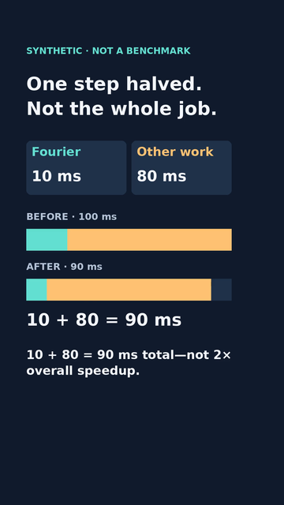
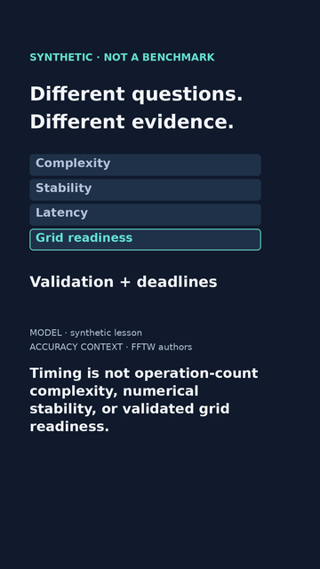

# FFT teaser · first complete silent encoded test

11 November 2026. **Rendered test, not a finished reviewed video.**
This 28-second vertical teaser supports the unchanged 80-second FFT v7
first milestone; it does not replace that 60–90-second explainer.
Owner review copy supplied separately, not a public movie destination.

## Exact candidate

- H.264, 1080×1920, 24 fps, 672 frames, 28.000 seconds, no audio.
- MP4 SHA256: `1ad0c7ed5ed0de7f14b0723ef3af37ab4e22b5c7616391a744c8a6fd136b4f50`.
- Inspected starting commit: `61f11c05c8c47011eb93645bd074075272b9da32`;
  modified rendering/QA sources are individually hashed in the report.
- [Candidate identity](teaser-render/candidate.json), [render report](teaser-render/render-report.json),
  [matching silent reading VTT](teaser-render/fft-latency-teaser.vtt).

| Decoded result · frame 288 / 12.000 s | Decoded ending · frame 671 / 27.958 s |
|---|---|
|  |  |

These PNGs come from the actual encoded MP4, not source-frame exports.
Movie bytes remain outside Git; local output is ignored under videos/out/.
No public video/lesson URL, QR or guessed call-to-action has been inserted.

## What was verified

The complete encoded stream was decoded with FFmpeg error stopping enabled.
FFprobe checks every decoded frame's timestamp, frame count/rates, dimensions,
duration and the absence of audio/extra streams. Twenty-nine samples were
exported across the six scenes, both sides of scene/focus cuts, and the end.
Expected captions in the report are supplied source metadata, **not OCR**.
Sample image paths in that report refer to the local review export, not
checked-in Git files; only the two representative PNGs above are committed.

Inspected decoded 360-wide samples at frame IDs
`0,95,96,191,192,287,288,407,408,527,528,563,564,599,600,635,636,671`
in five temporary cut sheets, plus result frame 288 and final frame 671
at full resolution. The synthetic label persists; the prediction does not
show 90 ms early; 20→10 ms and unchanged 80 ms lead to the exact 90 ms sum.
Caption/scene and closing-focus changes matched inspected cut samples.
No clipping found there. Four assumptions remain on their own screen.

Limits: this is sampled pixel inspection, not continuous human playback or
actual-device accessibility/comprehension evidence. The 1.5-second closing
focus holds may be too quick, and the secondary source/synthetic text is
small at 360 width. User interface overlays vary; layout reserves are not a
platform guarantee. Human/tablet timing and readability judgement remain
unchecked. There is no audio to listen to or align; adding authorized human
narration later requires new listening, retiming and synchronization review.

The new four tests cover silent VTT/cut coverage, vertical media geometry
and bad timestamps, no-overwrite/input guards, frozen candidate/source/report
identity. Existing all-source-frame tests remain intact. Final test counts
and status are recorded in [STATUS.md](../STATUS.md); passing code or decode
does not grant publishing authority or independent editorial approval.

## Reproduce or inspect another copy

From videos/, Python 3.11–3.13, uv, system DejaVu Sans and FFmpeg/FFprobe
with libx264 enabled:

```sh
uv sync --locked
uv run --locked python -m unittest discover -p 'test_*.py'
uv run --locked python fft_teaser_media.py --out out/teaser-new
uv run --locked python fft_teaser_media.py --video out/teaser-new/fft-latency-teaser-draft.mp4 --out out/teaser-review-new
```

Both paths refuse an existing destination. Failed operations may leave a
partial directory; no success report is written until checks complete.
The renderer validates distinct layouts first, then streams all 672 RGB
frames to local FFmpeg and invokes decoded QA. The new wrapper is separate
because existing study encoding is landscape-only; no old helper or frozen
source-frame asset was modified. Re-rendering elsewhere may produce different
bytes; compare source hashes, versions/fonts and decoded content, not only
filenames. Frame layout/content and six-cue timing remain unchanged.

The new VTT describes a silent reading track. The earlier teaser.json,
teaser.vtt and layout notes are retained, dated preproduction artifacts;
their historical “no movie” status is not the current render status.
Do not present either caption file as aligned speech or add a synthetic voice.

## Context, sources and rights

The example is synthetic sequential workload accounting: 100 ms comprises
20 ms Fourier work plus 80 ms other work. Halving only Fourier work gives
90 ms, not twice the whole-system speed. Same accuracy, unchanged other work
and no extra overhead are assumptions, not experimental findings. Parallel
pipelines may need a different model. Complexity, numerical stability,
whole-workload latency and real-time grid readiness remain separate claims.
No operational data, new FFT claim, real-time EMT promise or NS/RH conclusion.

The original source/inspiration ledger is in [TEASER.md](TEASER.md) and
[TEASER_LAYOUTS.md](TEASER_LAYOUTS.md). No creator footage, music, quotes,
voice, logos or distinctive assets were copied; discussion is not theorem
validation. Original code graphics only.

Tool inspection, 11 November 2026:

- [FFmpeg documentation](https://ffmpeg.org/ffmpeg.html), [FFprobe](https://ffmpeg.org/ffprobe.html) and [legal page](https://ffmpeg.org/legal.html). Tested external version is `7.1.5-0+deb13u1`, GPL-enabled with libx264; no FFmpeg/codec binary is bundled. Codec patent and distribution obligations are not presumed absent. Recheck terms before packaging/distributing tools or commercial release.
- [Pillow license](https://pillow.readthedocs.io/en/stable/about.html#license), installed pinned 12.3.0 notice and system DejaVu font notice inspected. Existing dependency/lockfile unchanged; fonts stay external, hashes recorded.

No paid service, subscription, purchase, account change or assumed Open
Notebook deployment. Nothing uploaded to YouTube/Substack/socials or merged.

## Next review gate

- [ ] Full silent playback on Karin's tablet: hook/result dwell and 22–28 s closing pace.
- [ ] Independent editorial/mathematical and rights review of the exact candidate.
- [ ] Decide silent versus authorized human narration; retime if audio is added.
- [ ] Verify lesson and public video destinations before adding a CTA.
- [ ] Reconcile stacked parent branch, then obtain explicit exact-version publication approval.

Next bounded increment: integrate timestamped feedback if available;
otherwise measure the closing screen's reading load and prepare one slower
alternative for comparison without replacing the frozen candidate or claiming
that a reading-rate calculation proves comprehension. No technical encode
blocker remains; this draft is still unapproved.
