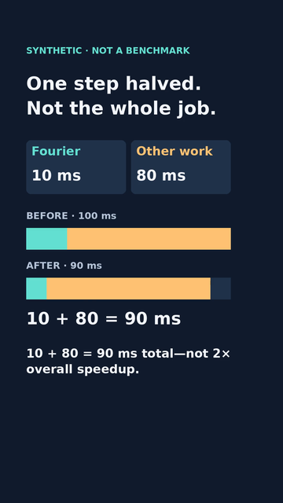
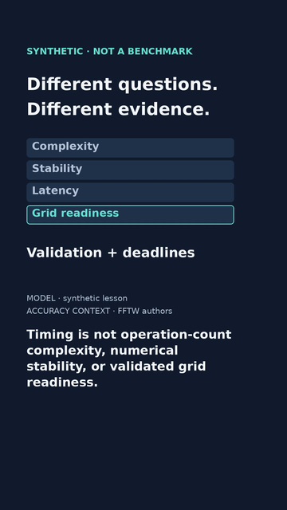

# FFT teaser · rendered slower comparison

12 November 2026. **Silent encoded draft, not a finished reviewed video.**
Same synthetic lesson and original visuals; only the four closing focus holds
double from 1.5 to 3 seconds. Total 34 seconds, not the primary 80-second pilot.
The frozen 28-second draft, full FFT v7 and curves episode are unchanged.
An owner review copy is supplied separately; no public movie destination exists.

## Exact candidate and comparison

- H.264, 1080×1920, 24 fps, 816 frames, 34.000 s, no audio; 461,078 bytes.
- MP4 SHA256: `7651d3e43a027947cf44efce39ecd76c14700e02df98a6d6a377fcdfde28405d`.
- Source baseline: `c1a0bf873111dbd73b161bcb17815fa6cf2aba29`.
- Compared with frozen [28-second draft](TEASER_RENDER.md), SHA256
  `1ad0c7ed5ed0de7f14b0723ef3af37ab4e22b5c7616391a744c8a6fd136b4f50`.
- [Candidate identity](teaser-slower-render/candidate.json),
  [source/tool/font hashes and decoded report](teaser-slower-render/render-report.json),
  [matching silent reading track](teaser-slower-render/fft-latency-teaser-slower.vtt).

| Decoded result · frame 288 / 12 s | Decoded ending · frame 815 / 33.958 s |
|---|---|
|  |  |

The PNGs above are decoded movie samples, not freshly drawn source frames.
The report's other image paths refer to local ignored review exports, not Git.
Its expected captions are mapped source metadata, not OCR or automatic approval.

## Actual checks and limitations

Complete stream decode and every-frame timestamp/count/rate/dimension/duration
checks pass. One video stream, no audio or added streams. Twenty-nine decoded
samples exported. Inspected 360-wide frames 0,95,96,191,192,287,288,407,408,
527,528,599,600,671,672,743,744,815 on three chronological cut sheets;
also inspected result 288 and final 815 at full resolution. No clipping or
caption/focus-cut mismatch found in those samples. Focus switches are at
22,25,28,31 seconds; the final frame still shows readiness, not an early cut.
The prediction withholds 90 ms until the result; all four model assumptions
and the persistent synthetic label remain. Neither more dwell nor a passing
test establishes comprehension. Secondary source/synthetic text remains small
at 360 width; complete actual-device playback is still required.

No continuous human playback, listening or speech alignment occurred. There
is no audio. The unrendered [timing storyboard/audit](TEASER_PACING.md) and its
provisional VTT remain historical source proposals; use the rendered reading
track linked above for this candidate. No new graphics or narration were added.

The new separate wrapper `fft_teaser_slow_media.py` uses the existing timing
adapter without editing frozen media/layout/model helpers. Four new tests cover
the 34-second format versus 28 seconds, bad timestamps, caption/focus cuts,
no-overwrite/input guards and frozen source/report/caption identity. Exact full
suite result is recorded in [STATUS.md](../STATUS.md). Tests and decoding are
not editorial, independent mathematical, rights or publication approval.

## Reproduce

From videos/, existing pinned environment, system FFmpeg/FFprobe and DejaVu:

```sh
uv sync --locked
uv run --locked python fft_teaser_slow_media.py --out out/slower-new
uv run --locked python fft_teaser_slow_media.py --video out/slower-new/fft-latency-teaser-slower-draft.mp4 --out out/slower-review-new
uv run --locked python -m unittest test_fft_teaser_slow_media -v
```

Both render/review refuse existing destinations. Failure may leave partial
output; no success report is written until checks complete. Different builds
may produce different bytes; compare source/tool/font identities and decoded
content, not just filenames. Large movie and review exports stay outside Git.

## Sources, rights and next action

The source ledger and assumptions remain in [TEASER.md](TEASER.md),
[layouts](TEASER_LAYOUTS.md) and [timing audit](TEASER_PACING.md).
100 ms means 20 ms Fourier plus 80 ms other sequential work; halving only
Fourier gives 90 ms. Same accuracy, unchanged other work and no added overhead
are assumptions. Operation-count growth, error behavior, end-to-end elapsed
time and validated grid readiness require different evidence. No new FFT,
operational benchmark, grid telemetry or research conclusion is claimed.

Official [FFmpeg](https://ffmpeg.org/ffmpeg.html),
[FFprobe](https://ffmpeg.org/ffprobe.html), [legal](https://ffmpeg.org/legal.html),
[Pillow licensing](https://pillow.readthedocs.io/en/stable/about.html#license)
and [FFTW accuracy context](https://fftw.org/accuracy/comments.html) rechecked
12 November. External FFmpeg 7.1.5 GPL/libx264 build, Pillow pinned 12.3.0 and
system DejaVu notices retained; no binary/font bundle or dependency change.
Codec/distribution obligations are not presumed absent. No paid service,
copied creator assets, voice cloning, private data or Open Notebook deployment.

Next bounded action is feedback/review, not a third pacing variant: compare
complete 28- and 34-second silent playback on Karin's tablet. Record where
the four concepts become distinguishable and which text is hard to read;
do not prefer one version from token rates alone. Then address one observed
problem. Independent editorial/math/rights review, audio/destination decisions,
stacked-parent reconciliation and explicit exact-version publication approval
remain unchecked. Nothing uploaded to YouTube/Substack/socials or merged.
