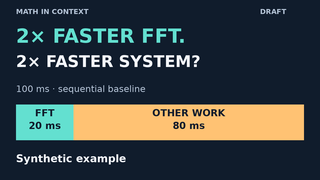

# Thumbnail candidate · prediction, not a performance announcement

**DRAFT FOR KARIN'S REVIEW · 2 November 2026 · not approved for upload.**


## Small-preview check



The question follows the video's prediction-first opening. The proportional
bar shows the **baseline**, not the improved workload. It intentionally does
not reveal 90 ms or imply a 2× overall gain. “Synthetic example” is explicit;
no new FFT, benchmark, grid readiness or research breakthrough is claimed.
The video supplies the sequential/same-accuracy/unchanged-other-work/no-added-
overhead assumptions before interpreting the result. No thumbnail can replace
those qualifications. No CTR, A/B result or virality prediction is asserted.

Suggested pairing: the draft title and description in [REVIEW.md](REVIEW.md).
Keep the prediction question's question mark. The qualifier and draft label
stay visible for review; removing any draft label requires editorial approval
and a newly inspected image. Text labels accompany the colors. The bottom-right
corner has no essential text, leaving room for a platform duration overlay.

## Reproduce or adapt

From `videos/`:

```sh
uv run --locked python thumbnail.py --out out/thumbnail-review
uv run --locked python -m unittest test_video test_qa test_thumbnail -v
```

Copy lives in `thumbnail.json`; numbers expand from the validated canonical
lesson model. `thumbnail.py` reuses the video's palette, font and measured
text fitting; it makes an original 1280×720 RGB PNG and a 320×180 reduction.
Existing output folders are refused. A changed scenario needs its own human
layout review: the renderer fails on overflowing text instead of silently
shrinking the labels or inventing non-proportional blocks. The alternate
200 ms/100 ms/4× fixture is tested, not proposed as the public episode.

The two small review PNGs are committed here so GitHub readers can inspect
them on a tablet. Other test/render outputs belong in ignored `videos/out/`.
Regenerate into a new output folder and inspect before replacing these assets;
do not overwrite a reviewed candidate silently. Font/renderer versions can
change pixels; exact dependencies remain pinned in the existing lockfile.

## Provenance and review limits

Original code-drawn rectangles and text only: no screenshots, stock images,
3Blue1Brown assets, logo files, voices, music, telemetry or private notes.
System DejaVu Sans is rasterized into the image; no font binary is bundled.
Existing [renderer source/license notes](../README.md#sources-and-provenance)
apply. Official [Pillow drawing docs](https://pillow.readthedocs.io/en/stable/reference/ImageDraw.html)
and [MIT-CMU license statement](https://pillow.readthedocs.io/en/stable/about.html)
were rechecked on 2 November 2026. The current docs describe Pillow 13.0.0;
we retain locked 12.3.0 and tested only the APIs used here. No new dependency,
paid service, license purchase or assertion that all commercial tooling is free.
[YouTube's official thumbnail help](https://support.google.com/youtube/answer/72431?hl=en)
was checked for context; no account eligibility, Shorts behavior or upload is
tested. This candidate is for the landscape pilot, not a vertical Shorts asset.

Inspected both full resolution and 320×180: hook, question mark, block labels
and synthetic qualifier are visible without clipping in these previews.
This is sampled desktop image review, not actual-tablet testing or approval.

- [ ] Karin reviews the hook and small-preview readability.
- [ ] Approve exact title/thumbnail/video revisions together before upload.

The silent v5 MP4, captions and Substack draft are unchanged. Remaining release
gates in [REVIEW.md](REVIEW.md) still apply; this image clears none of them.
