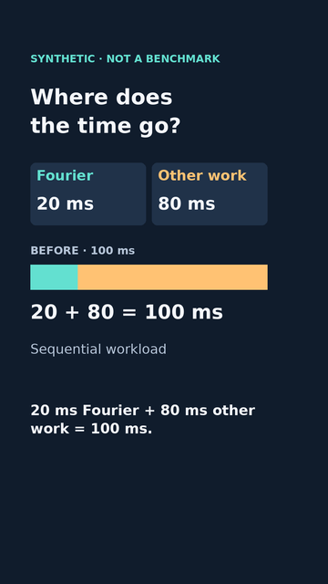
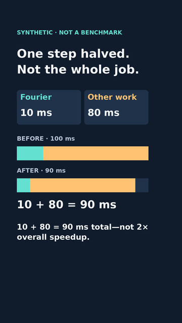

# FFT teaser · two original vertical keyframes

10 November 2026. **Still layout prototypes only**, not a rendered 28-second
teaser, encoded frames, audio track, approved release or replacement for the
unchanged 80-second FFT v7 first milestone.

Source baseline: `99a70b7cdbbaecc94086b932fc385a532d3c12a7` on
`codex/video-curves-storyboard`, draft PR #3. The synthetic numbers and caption
text resolve through the existing lesson/model/teaser data; the full lesson,
VTTs and existing media are unchanged. Proposed cue slots are 4–8 and 12–17
seconds, not verified playback or speech timing.

## Inspect the two layouts

| Baseline · proposed 4–8 s | Result · proposed 12–17 s |
|---|---|
|  |  |

Full-resolution [baseline](vertical-keyframes/baseline-1080.png) and
[result](vertical-keyframes/result-1080.png); intermediate
[baseline 540](vertical-keyframes/baseline-540.png) and
[result 540](vertical-keyframes/result-540.png).

Both bars retain a common 780-pixel / 100 ms scale. Other work stays 624 px;
Fourier changes from 156 to 78 px. The unused dark tail in the result is
reference space, not extra work. Cards label the colors; color alone is not
the explanation. Baseline does not reveal the result early. Only settled
totals appear. A persistent synthetic/not-a-benchmark label is retained.

The 1080×1920 canvas reserves x=90–900 and y=170–1550 for text. This is a
conservative design margin, **not a YouTube UI guarantee**. Live controls,
titles, device display and user accessibility settings can differ. The
minimum text is 34 design pixels (about 11 at 360 width); the disclosure
is secondary and smaller than the 46-pixel captions. Actual-device review
remains necessary.

## Reproduce and extend

From `videos/`, Python 3.11–3.13, uv and system DejaVu Sans:

```sh
uv sync --locked
uv run --locked python fft_vertical_keyframes.py --out out/vertical-new
uv run --locked python -m unittest test_fft_vertical_keyframes -v
```

The exporter refuses an existing directory and validates both layouts before
writing. It generates six PNGs plus report.json with exact image, source and
font SHA256 hashes, Pillow version, text ink bounds, bar geometry and proposed
cue/caption identity. Text wrapping uses actual glyph boxes and fails on
overflow; it does not silently shrink to illegibility. Copy/layout labels
live in vertical-keyframes.json, not embedded numeric strings in rendering.
Checked-in previews are review artifacts; regenerate them and their report
together after an intentional source edit. Tests detect stale sources/images.
Pinned dependencies and lockfile are unchanged.

## Sources and rights inspection

Rechecked 10 November 2026:

- [Pillow ImageDraw/textbbox](https://pillow.readthedocs.io/en/stable/reference/ImageDraw.html)
  for actual glyph bounds; [official license page](https://pillow.readthedocs.io/en/stable/about.html#license)
  identifies MIT-CMU terms. Current stable docs describe 13.0.0; execution
  deliberately retains locked Pillow 12.3.0 and tests the used APIs there.
  The pinned package's installed LICENSE was also inspected. No library
  binary is redistributed, and no claim about all commercial tools is made.
- System DejaVu Sans/DejaVu Sans Bold; inspected installed Bitstream Vera
  license and public-domain DejaVu changes at
  `/usr/share/doc/fonts-dejavu-core/copyright`. Fonts stay external; none
  bundled. Font file hashes are in report.json. Check notices if bundling later.
- Synthetic [lesson source](https://github.com/jeunjetta/math-in-context-/blob/7905dc2b30ad9c05436f4db4a03d9cfe34224ffc/apps/fft_and_latency.py)
  supplies accounting assumptions, not a measured performance claim.
- [FFTW authors' accuracy notes](https://fftw.org/accuracy/comments.html)
  support the separate accuracy discussion, not these invented timings.

All layouts and bars are original code. No clips, source screenshots, copied
3Blue1Brown assets, voices, music or operator data. Existing Python/Pillow
path is sufficient for these flat graphics; no Remotion switch, paid tool,
codec packaging or external service is needed for stills.

## Inspection and limits

Both full-size, 540-wide and 360-wide exports inspected: headline, component names,
equations and captions fit; unchanged amber length and halved teal length
are visible. The synthetic label is small at 360 width. The 540-wide pair
is also supplied for review. This is visual sampling of stills, not proof of
readability, comprehension, pacing, audio synchronization or actual-tablet
usability. No animation or teaser MP4 exists. The other four teaser beats,
including the four assumptions and claim-limit/source card, are not rendered.

Next bounded task: implement the other four layouts, then test every frame
and caption cut before the first full teaser render. Do not omit sequential
work, same accuracy, unchanged other work, no extra overhead, or the distinction
between complexity, stability, total latency and validated grid readiness.
Full-video human/editorial review, audio choice, verified destinations, rights,
parent-branch reconciliation and explicit exact-version publication approval
remain open. No publishing, merge or account setting change.
