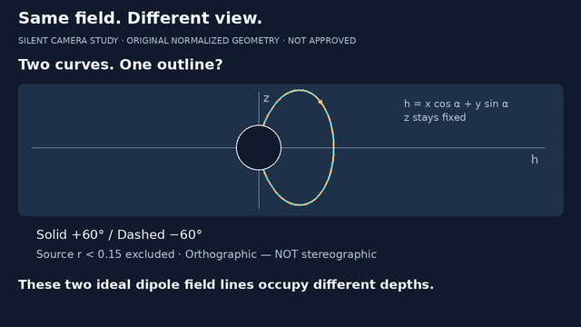
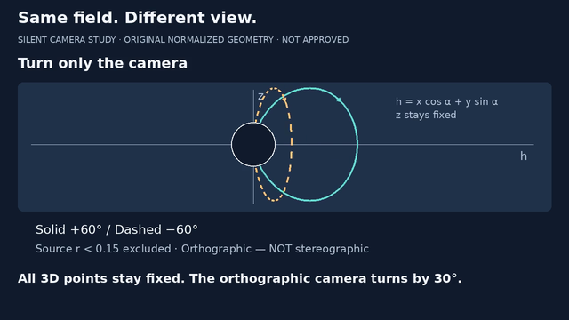
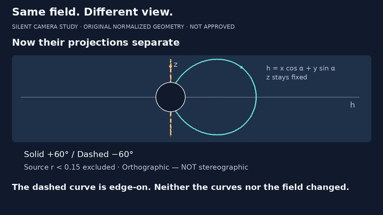
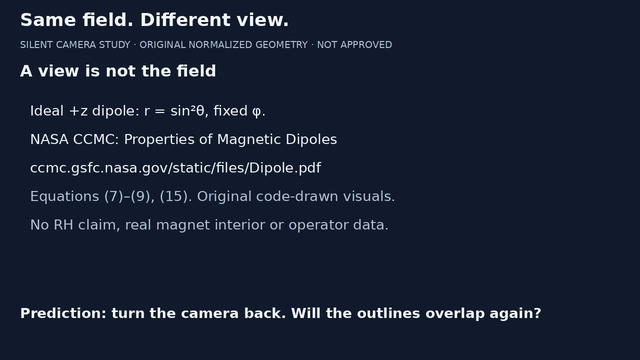

# Same field. Different view. · 6 November 2026

**32-second silent preproduction excerpt, not the full 82-second episode.**
The FFT/latency v7 pilot remains the first release milestone, unchanged.
Source baseline: PR #3 `12745869662ffd0093ef7e933d428fc4b56cc519`;
parent PR #2 `97c8aea386535f8eca8ffd00478f36b56adc364e`.

One narrow lesson: an orthographic camera can hide depth without changing a
physical field. Two fixed-azimuth ideal dipole lines, φ=±60°, overlap when
viewed along y. Only the camera turns; at 30° the negative-φ curve is edge-on.
The immutable 3D samples and direction checks remain in the geometry layer.
The model is normalized, source-excluded, not a real magnet interior or grid.

The concept link is **3D field line → camera projection → apparent shape**,
a representation link, not physical equivalence with a mapped complex grid.
This excerpt makes no RH, NS, stereographic or common-physics claim.

## What was rendered

| Time | Beat | Camera |
|---|---|---|
| 0–5 s | Two curves, one outline? | α=0° |
| 5–10 s | Looking along y hides depth | α=0° |
| 10–18 s | Turn only the camera | Smooth 0°→30° |
| 18–25 s | Projections separate; dashed curve edge-on | α=30° |
| 25–32 s | Source card and return-view prediction | No plot |

The script/reading track, scene times, rotation interval and labels live in
[camera-study.json](camera-study.json), separate from camera_study.py.
[camera-study.vtt](camera-study.vtt) is generated from those same cue intervals
as the burned captions. It is a silent reading track, not aligned narration.
No voice, music, impersonation or generated/cloned speech.

Review copy is supplied in the conversation, not uploaded to YouTube.
The MP4 stays under ignored out/, not in Git history.

## Encoded sample review









Render: H.264/yuv420p, 1280×720, 24 fps, **768 frames, 32.000 seconds**,
one video stream and no audio. Full FFmpeg decode passes.
MP4 SHA256: `ee67d1b210942c1665c384655b69e16eb76c80cd727ca6e2f22a7f12e74cd5e6`.
See [render identity and source hashes](camera-study-render.json).

- Full eight-module suite: **49 tests pass in 28.866 s**, including rendering
  all 768 source frames for text overflow. Four new tests cover cue/VTT
  freshness, angle continuity/monotonicity, fixed geometry and timing guards.
- Exported 23 encoded samples: every two seconds, first/last frames and both
  sides of caption cuts. [Sample metadata](camera-study-samples.json) lists
  frame indices/times; expected captions are not OCR verification.
- Inspected encoded frames 0, 119, 120, 239, 240, 336, 431, 432, 599, 600
  and 767, at full size and/or 640 wide, with source stills as an earlier
  layout check. No clipping or caption-cut mismatch found in those samples.
  Uninspected samples and unseen motion are not certified by this statement.
- Source mask is visible and sampled paths split before projection. The
  conservative screen disc may also hide retained points behind its outline;
  it represents an exclusion mask, not a solid physical magnet.
- Caption size is 28 px; active headings 32 px. These are larger/sequential
  than the earlier dense overview stills. The 22–24 px secondary formula
  and source-mask label remain small at 640 wide; actual-tablet review needed.
- Output-directory no-overwrite guard passed. Whitespace check passes.
- No listening/audio-sync check applies: no audio exists. Full human playback,
  mathematical/editorial review, actual-device and publication approval remain
  outstanding. A rendered test is not a finished reviewed video.

## Reproduce

From videos/, with the existing lock and installed DejaVu Sans/FFmpeg:

```sh
uv sync --locked
uv run --locked python -m unittest test_video test_qa test_thumbnail test_small_screen test_package test_curves test_curves_keyframes test_camera_study -v
uv run --locked python camera_study.py --out out/camera-study-new
uv run --locked python camera_study_qa.py out/camera-study-new/camera-study-draft.mp4 --out out/camera-study-new-qa
```

Both output directories must be new. Render writes MP4, matching VTT and a
hash/media report only after a full decode and format check. The QA exporter
is deliberately specific to this silent 32-second/24fps study; do not use
the FFT-specific qa.py or assume it accepts arbitrary videos/narration.
Tests used the existing pinned-version environment; no dependency or lockfile
changed. Exact encoder/font versions can affect pixels and hashes.

## Sources, tools and rights

Rechecked 6 November 2026:
[NASA CCMC dipole module](https://ccmc.gsfc.nasa.gov/static/files/Dipole.pdf),
Eqs. (7)–(9) and (15); existing field-line tangent tests match the model.
The full [storyboard](STORYBOARD.md) credits broader mathematical sources
and creator inspiration. No third-party illustration/clip was copied.

Retained Pillow 12.3.0 and the local FFmpeg 6.1.1-3ubuntu5/libx264 build.
[Pillow license](https://pillow.readthedocs.io/en/stable/about.html#license)
is MIT-CMU; no Remotion purchase or commercial-tier assumption.
FFmpeg website timed out; inspected its official
[license source](https://github.com/FFmpeg/FFmpeg/blob/master/LICENSE.md),
[CLI documentation source](https://github.com/FFmpeg/FFmpeg/blob/master/doc/ffmpeg.texi),
installed encoder help and packaged copyright instead. Build options affect
FFmpeg licensing; this GPL-enabled system binary and DejaVu font stay external,
not redistributed here. No blanket codec patent/distribution clearance claimed.
Repo code remains under its existing license; third-party tools keep theirs.

## Next bounded increment

Add the mapped-line versus potential/field-line opening as a staged segment,
then reconcile it with the 82-second storyboard and this excerpt's timing.
Do not stitch the 32-second test into the existing cut without retiming.
The excerpt alone does not deliver the full model comparison or a 3D
orientation demonstration. Improve the smaller secondary labels during that
integration and recheck encoded motion/pacing.

PR #3 remains a draft stacked on PR #2. Parent reconciliation, independent
mathematical/editorial review, human/tablet playback, audio decision and explicit
publication approval remain gates. No publishing, merge, external account change,
paid service, new automation, operator data or Open Notebook deployment.
