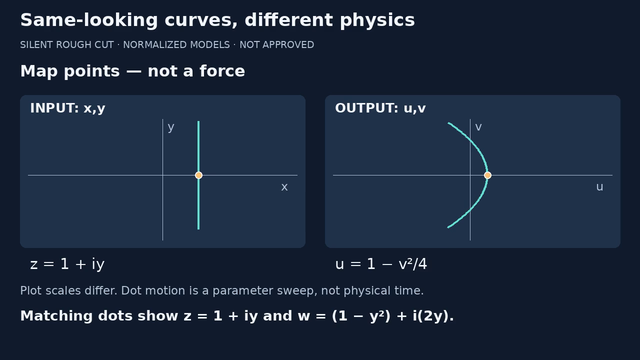
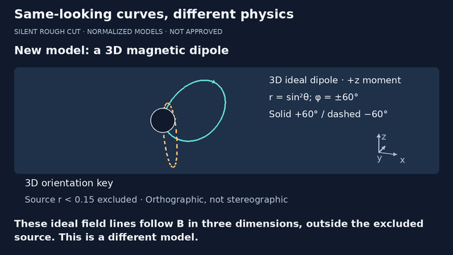
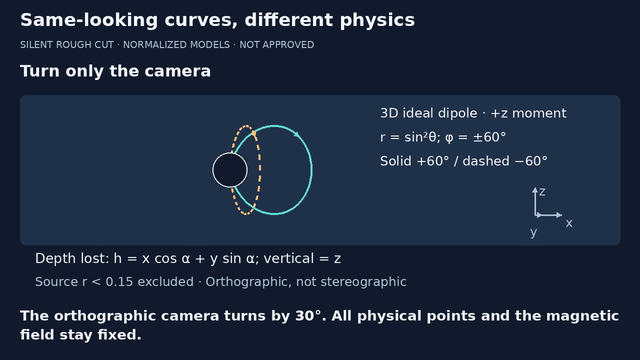
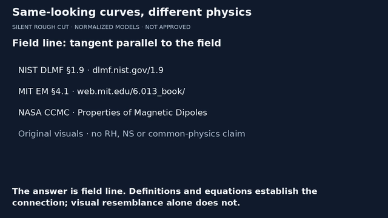

# Same-looking curves, different physics · integrated rough cut

**7 November 2026 · 86 seconds · silent · not approved for publication.**
Current candidate: [legibility v3 review handoff](REVIEW.md), with the same
timeline and lesson but larger camera-orientation/model labels. The original
v2 QA below is retained as history; its report has a versioned filename.
The later candidate now has a complete sequential rough cut, rather than
two concatenated studies. The FFT/latency v7 pilot remains the first release
milestone and is unchanged. This clears none of its review/lesson-link gates.

Source baseline: PR #3 `f4c40f736d1a5c8f9990a77cdf147ef1d25eccb7`;
parent PR #2 `97c8aea386535f8eca8ffd00478f36b56adc364e`.
The MP4 is supplied separately for owner review, not publicly uploaded or
committed. Small encoded previews and the render report accompany the code.

## Current timeline and script authority

| Time | Beat | Required distinction |
|---|---|---|
| 0–6 s | Define three kinds of curve | Point images, scalar levels, vector-field curves |
| 6–12 s | Input line x=1 | Input plane only; output still withheld |
| 12–22 s | Matched map points | Input x,y and output u,v stay separate |
| 22–30 s | Return to domain; choose a potential | Re(z²) is a modelling construction |
| 30–38 s | Contours versus field lines | Constant V versus tangent parallel to E |
| 38–48 s | A new 3D ideal dipole model | Oblique orientation, two fixed curves, source mask |
| 48–54 s | Labelled camera cut | Looking along y makes distinct depths overlap |
| 54–64 s | Camera-only turn | Physical samples stay fixed |
| 64–70 s | Settle at 30° azimuth | Dashed curve edge-on, not physically collapsed |
| 70–76 s | One recap question | Which object's tangent follows its field? |
| 76–86 s | Answer and primary sources | Field line; resemblance is not proof |

[episode.json](episode.json) is the authoritative copy/timing for THIS silent
cut. [episode.vtt](episode.vtt) is generated from exactly its burned reading
track. The old 82-second script.json is retained as an earlier unrecorded
spoken proposal, not this render's script or an audio-aligned transcript.
The separate map/camera studies and their render identities remain unchanged.
No voice or music exists; no audio synchronization claim is made.

## Equations, coordinates and concept links

The analytic bridge remains the explicit polynomial w=z². On x=1,
u=1−y² and v=2y, so u=1−v²/4. A moving point is a parameter sweep,
not physical time; the distinct plot scales are labelled. The origin's
critical derivative is not used to claim global angle preservation.

Returning by a labelled cut to domain x,y, choose the local normalized
2D electrostatic model V=Re(z²)=x²−y². Then E=−grad V=(-2x,2y).
Dashed contours V=±1 differ from solid directed xy=±0.6 field lines.
At the origin E=0; the hollow marker has no field direction. Orthogonality
is claimed only for regular contours. No real electrode boundary problem
or physical equivalence to the image of the input line is asserted.

The new model is the source-excluded normalized +z ideal magnetic dipole:
B=(3xz,3yz,3z²−r²)/r⁵, with field lines r=sin²θ and fixed φ=±60°.
This is not a real magnet interior, terrestrial grid telemetry or SI data.
Existing immutable geometry is reused; samples inside r<0.15 are split out
BEFORE projection. A conservative screen disc masks the projected exclusion
region; it can occlude retained points too and is not a solid magnet.

For the orientation shot, use orthographic screen coordinates
h=x cos α+y sin α and
v=z cos β+(-x sin α+y cos α)sin β, with α=β=20°.
The rows are orthonormal, so it is a camera projection, not a shear or new
physical law. The separate orientation key projects +x,+y,+z directions;
it is not a field-strength vector. The physical moment remains along +z.
The labelled cut at 48 s resets to α=β=0; only α then turns to 30°,
β=0, recovering the earlier h,z camera exactly. A depth-axis arrow can
project to a dot and projected axes can overlap. This is expressly NOT
stereographic projection. No shape/angle preservation is inferred.

Concept graph: analytic function → harmonic real part → chosen local
potential → gradient field; independently, 3D field lines → camera image.
The first arrows include a modelling choice; the last is representation
with lost depth. No RH/NS research or common-physics conclusion is used.

## Reproduce and extend

From videos/, using the existing pinned lock and external DejaVu/FFmpeg:

```sh
uv sync --locked
uv run --locked python -m unittest test_curves_episode -v
uv run --locked python -m unittest test_video test_qa test_thumbnail test_small_screen test_package test_curves test_curves_keyframes test_camera_study test_map_study test_curves_episode -v
uv run --locked python curves_episode.py --out out/episode-new
```

Use a NEW output directory. curves_episode.py routes one cue clock through
original drawing primitives and a fresh map-study configuration, without
mutating either old study. study_media.py performs silent encoding, full
decode, media checks and sampling. Scene data is separate from rendering;
the fixed camera geometry and map/field math helpers remain reusable.
Dependencies/lockfile are unchanged. Source hashes in episode-render.json
identify exact added code; source_commit means the prior inspected remote
baseline, not a claim that added files already existed in that commit.
System encoder/font differences can change rendered pixels and hashes.

## Historical v2 QA and review limits

Actual final candidate: H.264/yuv420p, 1280×720, 24 fps, **2,064 frames /
86.000 seconds**, one video stream, no audio. Complete decode and ffprobe
media checks pass. SHA256:
`7a8358fc3fec937d482d4d5c5614d599698f76b4629a57f6c91baa4d35075236`.
[Historical v2 render identity, hashes and sample times](episode-v2-render.json).
All **58 tests pass in 56.807 s**, including five new episode tests.

63 encoded samples exported. Visually inspected final frames
0,408,528,1008,1151,1152,1416,1536,1823,1824,2063 at 640×360.
These include the orientation/view cut and question/answer cut, not every
cue boundary or all intervening motion. No clipping/caption mismatch found
in the inspected samples; small plot labels/orientation key still need
actual-tablet review. The first encoded candidate's over-specific
"y-depth lost" label during rotation was corrected to general depth loss
before this final render; only the initial view now says looking along y.









Focused tests cover contiguous reading budgets/cue cuts, VTT freshness,
motion/cue lockstep, orthonormal projection rows, recovery of the earlier
camera, unchanged geometry/lesson data, curve bounds and all 2,064 source
frames fitting. Text fitting is not accessibility or mathematical approval.
The source review caught a panel escape and a legend/axis overlap; both
were corrected before the final encoded candidate. See STATUS.md for the
actual full-suite result, hash, decoded-frame review and remaining findings.

The entire integrated cut requires human playback and independent
mathematical/editorial review. Primary/secondary text may still need tablet
adjustment. Check pacing and comprehension, not just frame bounds; if a
human voice is later recorded, retime this track to the recording. No
technical render blocker, but no release approval or deployment is implied.

## Sources, rights and tool decision

Rechecked 7 November 2026:

- [NIST DLMF §1.9](https://dlmf.nist.gov/1.9), harmonic real/imaginary parts,
  Eq. 1.9.26. The polynomial identities above are directly reproduced.
- [MIT Electromagnetics §4.1](https://web.mit.edu/6.013_book/www/chapter4/4.1.html),
  negative gradient of potential. No diagrams copied.
- [NASA CCMC dipole module](https://ccmc.gsfc.nasa.gov/static/files/Dipole.pdf),
  Cartesian components Eqs. (7)–(9), field-line Eq. (15), printed pp.2,4.
  Original code-generated visuals, not NASA illustrations.
- Official [Pillow ImageDraw docs](https://pillow.readthedocs.io/en/stable/reference/ImageDraw.html)
  and [license](https://pillow.readthedocs.io/en/stable/about.html#license).
  Retained tested 12.3.0, MIT-CMU; current stable docs are newer.
- Official FFmpeg [CLI source](https://github.com/FFmpeg/FFmpeg/blob/master/doc/ffmpeg.texi)
  and [license](https://github.com/FFmpeg/FFmpeg/blob/master/LICENSE.md).
  External system FFmpeg/libx264 is GPL-enabled; no binaries/fonts are
  redistributed and no blanket commercial or codec patent clearance claimed.

Kept the existing Python/Pillow renderer rather than introducing a new tool
or paid service. No purchased license, fabricated voice, cloned likeness,
copied 3Blue1Brown assets, private notebook export or operator data. Broader
creator inspiration is credited in STORYBOARD.md, not theorem validation.
Open Notebook remains a separate source repository, not assumed deployed.

The subsequent chronological sample audit, legibility change and exact-version
checklist are recorded in REVIEW.md. Next: obtain human feedback against that
specific candidate and address a timestamped issue rather than assuming approval.
PR #3 remains draft/stacked on #2;
parent reconciliation, human/tablet review, audio choice and specific
publication approval remain gates. No upload, merge or account change.
