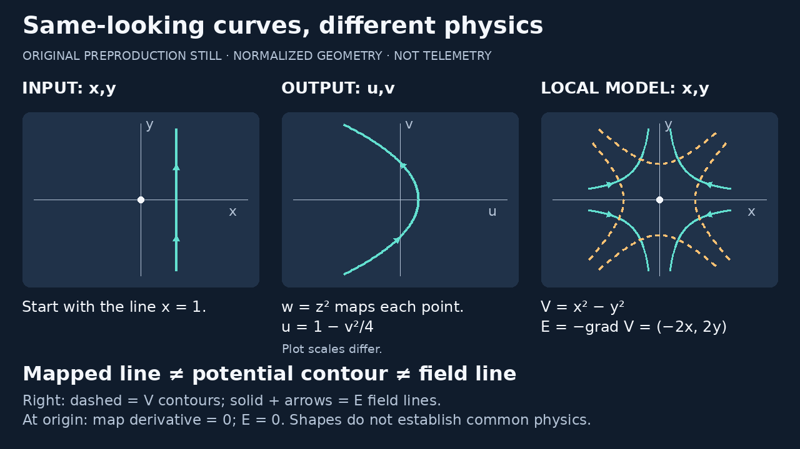
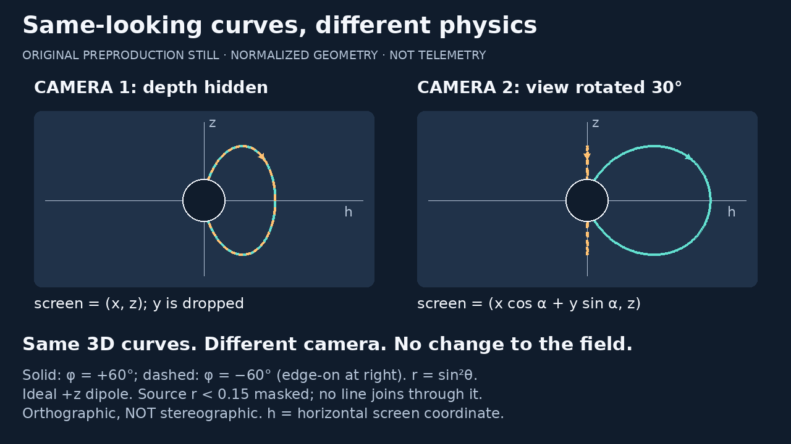

# Original comparison keyframes · 5 November 2026

Preproduction stills, not an animated, reviewed or publication-ready video.
Fresh source: draft PR #3 at `8ca5c5861ddd9423583f68006a13df26cc4da8fd`;
parent PR #2 remains at `97c8aea386535f8eca8ffd00478f36b56adc364e`.
The first milestone remains the FFT/latency v7 pilot, unchanged.

## Map, potential, field




Left: a line in the domain. Middle: its image under w=z², in different
coordinates and a different display scale. Right: dashed V-contours and
solid, directed E-field lines in the domain of a chosen local potential.
These are distinct definitions; the analytic-to-harmonic relation is real,
but it does not make all these curves the same physical object.

## Only the camera changes




The two fixed physical curves have φ=±60°. Looking along y hides their depth
separation. Rotating the orthographic view 30° separates their projections;
the negative-φ curve is then edge-on. No physical curve or field changes.
Positive z-directed normalized ideal dipole; no real magnet interior modeled.

The renderer splits the sampled 3D paths at r<0.15 before projection and
does not connect through that gap. The outlined screen disc is a conservative
occlusion mask: it also hides any retained projected points behind that disc.
It is not a physical solid magnet. Arrows follow increasing colatitude,
parallel to B on these curves; chosen line density does not measure strength.
This is not stereographic projection. See the [storyboard](STORYBOARD.md)
for equations, assumptions and primary-source roles.

## Reproduce and extend

From videos/, use the existing Python 3.11–3.13 / Pillow 12.3.0 lock:

```sh
uv sync --locked
uv run --locked python -m unittest test_curves test_curves_keyframes -v
uv run --locked python curves_keyframes.py --out out/curves-review-new
```

The output folder must not exist. Each export produces two 1280×720 PNGs
and two 640×360 Lanczos previews. Text/equations are editable in
keyframes.json; geometry functions remain in curves_models.py; composition,
source masking and sampling are in curves_keyframes.py. Existing reusable
font/text fitting comes from render.py. No new dependencies, services or
assets. The model and script are unchanged. Exact font/system versions may
change pixels; inspect new exports, not only test results.

## QA observations and limitations

- Full seven-module video suite: **45 tests pass in 24.979 s**, including
  four new keyframe tests and the existing FFT regression/layout checks.
- Whitespace check passes. Render used the existing locked-version environment
  (Pillow 12.3.0); no MP4 was rerendered or replaced.
- Inspected both compositions at 1280×720 and 640×360.
- Initial mapping render escaped its panel; final output scale is 30 px/unit.
  A 201-point bounds regression guards the plotted mapped line and margins.
- Direction arrows, coordinate labels, dashed/solid distinctions and the source
  mask remain visible. No clipping or text overlap found in the final stills.
- At 640 pixels wide, main teaching text is legible in the inspected raster;
  secondary disclaimers and formulas are dense/small. Future animation should
  reveal panels and explanatory lines sequentially at larger size, not freeze
  these dense overview cards as the full lesson.
- Automated tests cover source-domain splitting, camera overlap/separation,
  text overflow, export dimensions and no-overwrite guards. They do not prove
  the general field equations, accessibility or real-tablet usability.
- No MP4, audio, captions, timing or synchronization review in this increment.
  No human mathematical/editorial approval, tablet playback or publication.

## Sources, assets and licensing

Rechecked 5 November 2026: official
[Pillow ImageDraw documentation](https://pillow.readthedocs.io/en/stable/reference/ImageDraw.html)
and [MIT-CMU license statement](https://pillow.readthedocs.io/en/stable/about.html#license).
The current stable docs describe 13.0.0; we retain the already locked 12.3.0
and use established line, polygon, ellipse and text APIs tested locally.
No Remotion or encoder is added for these stills; no commercial tier assumed.
Pillow is not relicensed by this work. System DejaVu Sans is not bundled;
retain its applicable notices if distributing fonts. Repo license is Apache-2.0.

Equations are implemented in original code; no footage, screenshots, creator
assets, voices, logos, music, private notes, NS conclusions or telemetry.
[NASA CCMC dipole module](https://ccmc.gsfc.nasa.gov/static/files/Dipole.pdf),
Eqs. (7)–(9), (15), was rechecked for the dipole and line formulas.
NIST/MIT sources and creator inspiration remain credited in the storyboard.
No RH or common-physics claim is made.

Next: stage these elements into a short silent animatic, with larger sequential
labels and a source/end card. Only then inspect motion and reading times.
Parent PR reconciliation, mathematical/editorial review, actual-device review,
audio decision and explicit publication approval remain open gates.
