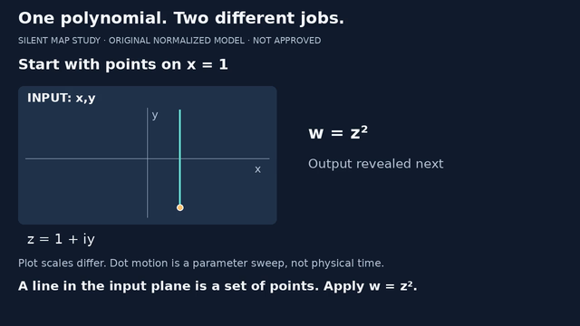
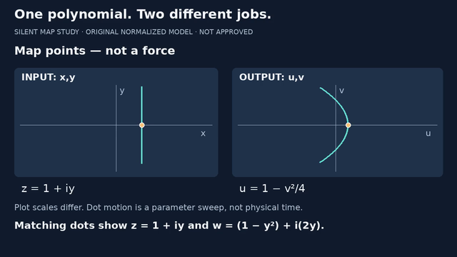
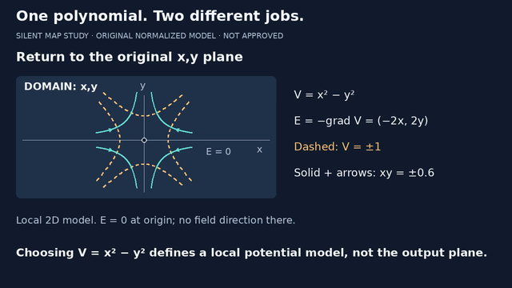
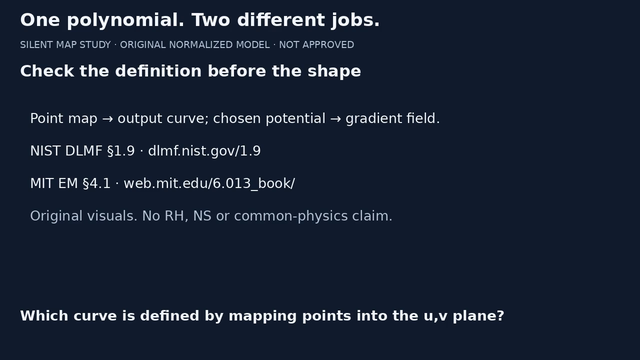

# One polynomial. Two different jobs.

**32-second silent preproduction excerpt · 6 November 2026 · not approved.**
The FFT/latency v7 pilot remains the first release milestone, unchanged.
Source baseline: PR #3 `fe359523a6c6c65c40c6f070bd7f4e1042816293`;
parent PR #2 `97c8aea386535f8eca8ffd00478f36b56adc364e`.

Concept links: complex point map → output curve; choosing its real part as a
potential → gradient field in the original domain. These are different
operations, not a shape-based identification of physical systems.

## Inspect the draft

The playable silent draft is supplied separately to the owner for review;
there is not yet a public video URL.
The small previews below are tracked for public code review. The MP4 stays
under ignored out/, not in Git history or on YouTube.

| Time | Beat | Distinction |
|---|---|---|
| 0–6 s | Input line x=1 | A set of points, not a trajectory |
| 6–14 s | Matched points under w=z² | Separate input x,y and output u,v planes |
| 14–22 s | Labelled cut back to domain | Choose V=x²−y² and E=−grad V |
| 22–27 s | Dashed contours, solid directed lines | Constant potential versus field direction |
| 27–32 s | Sources and prediction | Definitions before resemblance |

[map-study.json](map-study.json) holds lesson copy, cue times, labels and sweep
interval. [map-study.vtt](map-study.vtt) uses the same cues as burned captions.
It is a silent reading track, not narration-aligned subtitles. No speech,
music, cloning, copied footage or external visual assets.









## Mathematical scope and assumptions

For z=1+iy, w=z²=(1−y²)+i(2y), hence u=1−v²/4. The moving
amber dots show this point correspondence; their sweep is a parameter, not
physical time. Plot scales differ and are labelled. This restricted input
line does not encounter F'(0)=0; no global injectivity or angle-preservation
claim is made for z².

Back in the original x,y plane, choose the local normalized 2D model
V=Re(z²)=x²−y². Its Laplacian is zero, but interpreting it as a potential
is a modelling choice, not proof of a real device's boundary conditions.
E=−grad V=(−2x,2y). Dashed V=±1 contours are hyperbolas. The solid
non-axis field-line branches satisfy xy=±0.6, since
E·grad(xy)=(-2x)y+(2y)x=0. Arrows follow E; they do not encode strength.
Field lines cross regular potential contours normally. The origin has E=0
and no field direction; it is marked with a hollow white symbol distinct
from the amber map dots. No SI measurements, global electrode solution,
real grid data, RH/NS proof or common-physics claim.

## Validation and limits

H.264/yuv420p, 1280×720, 24 fps, **768 frames / 32.000 seconds**, one video
stream, no audio. Full FFmpeg decode and ffprobe shape/timing checks pass.
MP4 SHA256:
`5dae3c75451ab655ae6996a376fe13a846e09ab95162f7af7ddde612f96286bb`.
[Render report](map-study-render.json) records baseline, source hashes,
encoder and the 25 exported encoded-frame sample times.

Focused tests check exact rational point correspondence and bounds, contour
values, tangent/direction residuals, cue boundaries, VTT freshness, invalid
inputs, timing consistency and every source frame's text fitting.
The complete nine-module suite passes **53 tests in 77.674 s**;
STATUS.md records the same result.

Encoded frames 143, 144, 240, 335, 336, 527, 528, 647, 648 and 767 were
visually inspected at 640×360 after encoding, including both sides of all
four caption cuts. No clipping or cut mismatch found in those samples.
The source-frame review caught a plot-label overlap; it was fixed before
the encoded render by moving E=0 clear of the curves and using a distinct
origin symbol. Sampling is not full motion/playback approval. Secondary
axis/zero-field labels remain small at 640; actual-device, mathematical and
editorial review are still required. No audio-sync check applies.
Existing-output refusal was tested before encoding; dependencies unchanged.

## Reproduce and extend

From videos/, using the existing lock plus external FFmpeg/libx264 and DejaVu:

```sh
uv sync --locked
uv run --locked python -m unittest test_video test_qa test_thumbnail test_small_screen test_package test_curves test_curves_keyframes test_camera_study test_map_study -v
uv run --locked python map_study.py --out out/map-study-new
```

Use a new output directory. map_study.py contains scene drawing and a
half-open cue selector. study_media.py handles silent single-stream encoding,
complete decode, cut/midpoint/two-second sampling and provenance independently
of the lesson geometry. Shared geometry and text/arrow helpers are reused;
the existing camera and FFT implementations are not modified.
The report's source_commit means the prior remote baseline, with the listed
source hashes identifying the added code; it is not a claim that new files
already existed at that baseline. Encoder/fonts can change pixels by system.

## Primary sources and asset/tool provenance

Rechecked 6 November 2026:

- [NIST DLMF §1.9](https://dlmf.nist.gov/1.9), harmonic functions and Eq. 1.9.26:
  real/imaginary parts of an analytic function are harmonic. The quadratic
  identities above are independently reproduced arithmetic, not copied art.
- [MIT Electromagnetics §4.1](https://web.mit.edu/6.013_book/www/chapter4/4.1.html):
  electric field as negative potential gradient.
- [Pillow ImageDraw documentation](https://pillow.readthedocs.io/en/stable/reference/ImageDraw.html)
  and [MIT-CMU license](https://pillow.readthedocs.io/en/stable/about.html#license).
  Retained tested Pillow 12.3.0 from the pinned lock, despite newer stable docs.
- Official FFmpeg [CLI source](https://github.com/FFmpeg/FFmpeg/blob/master/doc/ffmpeg.texi)
  and [license](https://github.com/FFmpeg/FFmpeg/blob/master/LICENSE.md).
  Tested system FFmpeg 6.1.1-3ubuntu5/libx264 is GPL-enabled; build licensing
  matters. No encoder binary/font is redistributed or blanket commercial-use
  or codec patent clearance claimed. No paid service or Remotion purchase.

All graphics are original code-generated plots/type. DejaVu Sans is supplied
by the external system installation. Broader creator inspiration is credited
in STORYBOARD.md, not used as theorem validation or copied assets.

## Next bounded step / exact outstanding gates

Reconcile this study and CAMERA_STUDY.md with the full 60–90-second episode:
retime a coherent opening, 3D orientation, camera turn, question and sources.
Do not simply concatenate two 32-second studies with duplicate end cards.
The old 82-second spoken script is still unrecorded, not a completed cut.
No technical render blocker. Full-episode integration, independent
mathematical/editorial and human/tablet playback review, audio choice, PR #3
parent reconciliation and exact-version publication approval remain open.
Open Notebook is a source-management repository, not assumed deployed.
No FFT/research changes, publication, merge or new automation.
