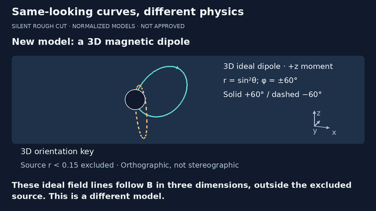
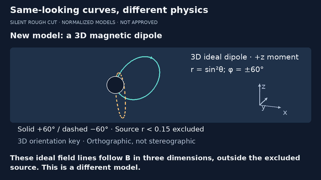
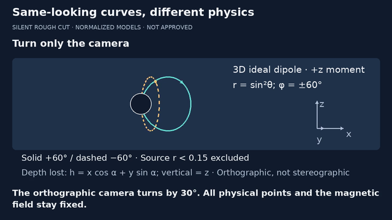

# Curves episode · exact-version review handoff

**7 November 2026 · legibility v3 · silent draft · no publication approval.**
The 86-second cut is unchanged in content, geometry and cue timing. This
revision addresses the small orientation key in the 38–70 s dipole segment.
FFT/latency v7 remains the first release milestone and is untouched.

Candidate identity: [review-candidate.json](review-candidate.json).
MP4 SHA256: `f252ab6d34b79c8011c9a4bd71cb8547ceb42bd3797aa675e07e13325d65bc10`.
86.000 seconds, 1280×720, 24 fps, 2,064 frames, H.264/yuv420p, no audio.
[Render report and exact source hashes](episode-render.json).
Review only this version; an earlier approval does not transfer automatically.
Playable copy is supplied separately to Karin, not a public YouTube URL.

## Bounded visual change

- Projected-axis arrows: 55 → 90 source pixels; label font 25 → 30 px.
- Dipole model/formula font: 26 → 30 px. The curve legend moves to its own
  lower line, preserving both solid/dashed identity and source exclusion.
- Projection note and orthographic/not-stereographic warning occupy a
  separate line. No camera/field coordinates, curve masks or caption times
  change. Layout settings now live in lesson JSON, not just drawing code.
- A new bounds/depth-dot test covers the orientation and camera interval.
  It does not certify actual-device readability or mathematical correctness.







## Chronological sample audit — not playback approval

Baseline MP4 was checked against its known hash
`7a8358fc3fec937d482d4d5c5614d599698f76b4629a57f6c91baa4d35075236`.
Its report is retained as [episode-v2-render.json](episode-v2-render.json).
Inspected baseline encoded frames in order: 0,216,408,624,816,1008,1224,
1416,1608,1752,1944, all at 640×360. This was a chronological sample review,
not continuous playback or a timed human reading test.

| Time range | Observed / remaining review issue |
|---|---|
| 0–22 s | Definitions, withheld output and matched dots stay distinct; secondary axis/scale labels remain small |
| 22–38 s | Domain return and E=0 qualifier visible; equations require attentive reading |
| 38–70 s | Orientation key was undersized; enlarged here, without altering projection or physical curves |
| 70–86 s | Recap question and answer/source card remain separate; six-second question budget needs human pacing feedback |

Automated cue budgets are not comprehension measurements. No conclusion
about audience performance follows from the sample review. The source-mask
disc is conservative projected occlusion, not a real magnet interior.

## Reviewer checklist — leave unchecked until actually reviewed

The full timeline, equations, assumptions and primary links are in
[EPISODE.md](EPISODE.md); this cut's exact reading track is
[episode.vtt](episode.vtt), driven by [episode.json](episode.json).

- [ ] Confirm candidate/hash above matches the video being reviewed.
- [ ] Watch the complete 86 seconds continuously; note timestamps needing pause/replay.
- [ ] On a real tablet, read captions, model formulas, source qualifier and orientation labels without zooming.
- [ ] At 12–22 s, identify input x,y versus output u,v and interpret dots as a parameter sweep, not time evolution.
- [ ] At 22–38 s, recognize the chosen potential as a modelling construction, not the output plane; distinguish contours from field lines and exclude E=0 from directional claims.
- [ ] At 38–70 s, distinguish the new ideal 3D model, excluded source, labelled camera cut, depth loss and edge-on view; confirm no physical field change is implied.
- [ ] At 70–76 s, answer the recap comfortably before the reveal; report any answer leakage or insufficient time.
- [ ] Independently review equations, geometric claims, source links, rights and model limitations.
- [ ] Decide whether this should remain silent or use authorized human narration. If narration is added, retime/listen/check captions against that exact recording.
- [ ] Reconcile stacked PR #3 with parent #2 before any eventual integration.
- [ ] Give explicit approval for the exact final media and publishing destination before upload.

Feedback format: candidate + timestamp + what was unclear + proposed change.
Comments on PR #3 are sufficient; no local development tools are required.
None of these boxes is marked by automated tests, rendering or this document.

## Reproduction and current limits

Actual validation: **60 tests pass in 46.527 s**, including the two new
orientation-key and review-identity regressions. Full encode/decode/media
checks pass; 63 encoded samples exported. Inspected final 640×360 frames
0,408,816,1008,1224,1416,1608,1824: no clipping/caption mismatch found
there. This is sampled raster inspection, not full playback or every cue cut.
Secondary scale/axis labels and the long projection formula still need real
device feedback. Output-directory refusal and whitespace checks pass.

```sh
# from videos/, existing pinned environment and external FFmpeg/DejaVu
uv sync --locked
uv run --locked python -m unittest test_curves_episode -v
uv run --locked python curves_episode.py --out out/episode-new
```

Use a new output directory. The same silent encoder performs full decode,
media checks and 63 cut/midpoint/two-second sample exports. The exact test
result and inspected final frames are recorded in STATUS.md. A second
test binds this review's candidate identity to the report and source hashes;
it detects narrow drift, not approval or a mathematical proof.

Retained tested Pillow 12.3.0; official ImageDraw docs and MIT-CMU license
rechecked 7 November 2026. External FFmpeg 6.1.1/libx264 build licensing is
GPL-enabled; no binary or font redistribution, paid service or blanket
commercial/codec clearance. Links and asset provenance remain in EPISODE.md.
All visuals are original. No third-party clip, cloned voice, operator data,
private NS research claim or assumed Open Notebook deployment.

No technical render blocker. Full human/tablet playback, independent
mathematical/editorial review, audio choice, parent reconciliation and
specific publishing approval remain open. No upload, merge or account change.
