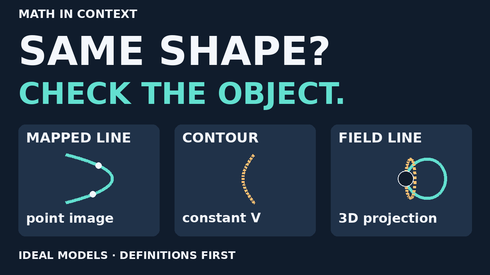
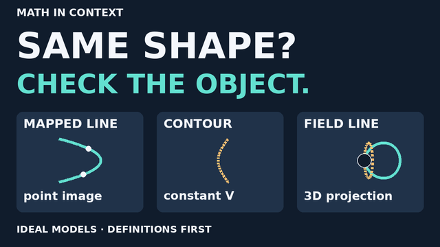
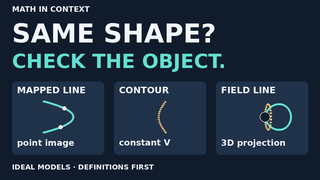

# Curves episode · one original thumbnail option

**8 November 2026 · draft for review, not selected or published.**
Source baseline: PR #3 `63996c504f0ad17092a618954a5b00dfc12320f6`.
Bound to legibility-v3 media SHA256
`f252ab6d34b79c8011c9a4bd71cb8547ceb42bd3797aa675e07e13325d65bc10`.
The 86-second silent movie, title/description package, cues and equations are
unchanged. FFT/latency v7 remains the first release milestone.

## Hook and intended reading

“Same shape? Check the object.” The question invites definition-checking;
it does not assert that these three curves coincide, or that electrical
and magnetic physics share no underlying theory. No click-through-rate
measurement or audience-performance claim has been made.







The copy and full descriptive alt text live in [thumbnail.json](thumbnail.json).
Large text, contrast, words and solid/dashed cues avoid color-only meaning.
This is one option, not an A/B experiment or a final approved cover.

## Geometry and honest simplifications

- Left: image of x=1 under w=z²; u=1−v²/4 in the output plane. Matching
  dots indicate point images, not force vectors or physical time.
- Middle: one regular V=1 branch of the chosen local potential V=x²−y².
  It is dashed and has no direction arrow. This is not an E field line.
- Right: the episode's fixed φ=±60° ideal dipole curves, projected by the
  existing orthographic camera at azimuth 20°, elevation zero. This is
  a representative view, not the full moving-camera demonstration.
  Physical r<0.15 is excluded before projection. The additional screen
  disc conservatively occludes points; it is not the interior of a magnet.
- Panels have different scales and no metric axes. The curves are clipped
  only by their chosen parameter windows, not morphed into one another.
  Do not infer equal coordinates, angles or common physics from the cover.

Concept placement: point map / scalar level / vector-field curve →
recognizing the represented mathematical object. Engineering relevance is
reading plots correctly, not a tested operational tool or new grid claim.
Definitions and source roles remain in [EPISODE.md](EPISODE.md) and
[PACKAGE.md](PACKAGE.md): [NIST DLMF §1.9](https://dlmf.nist.gov/1.9),
[MIT EM §4.1](https://web.mit.edu/6.013_book/www/chapter4/4.1.html),
[NASA dipole geometry](https://ccmc.gsfc.nasa.gov/static/files/Dipole.pdf).
No new research claim is introduced or Navier–Stokes checkpoint used.

## Provenance and reproduction

Original geometry/layout drawn by code; no stock images, creator footage,
logos, generated voices, paid service, private notes or telemetry. Reuses
curves_models.py, curves_keyframes.py and render.py without modifying them.
Copy is separate from drawing code in curves_thumbnail.py. Retained pinned
Pillow 12.3.0 and the existing uv.lock; no dependency or binary/font added.

Official [ImageDraw documentation](https://pillow.readthedocs.io/en/stable/reference/ImageDraw.html)
and [MIT-CMU license](https://pillow.readthedocs.io/en/stable/about.html#license)
rechecked 8 November 2026; current stable docs are newer than the retained
tested pin. System DejaVu Sans Bold is not redistributed; existing font
licensing notes in the video README still apply. No blanket distribution
or commercial-rights clearance is claimed. No FFmpeg run was needed here.

From videos/, with the existing locked environment:

```sh
uv run --locked python curves_thumbnail.py --out out/curves-thumbnail-new
uv run --locked python -m unittest test_curves_thumbnail -v
```

Use a new output directory: export refuses overwrite. It writes PNGs at
1280×720, 640×360 and 320×180, with image/source/font hashes and Pillow
version in report.json. System fonts can change pixels across machines.
[Committed preview report](thumbnail-previews-v2/report.json) binds these
images to the intended media; it grants no approval.

## Inspection and outstanding review

Inspected full-size first draft and both smaller sizes; corrected the
initial overly categorical footer to “ideal models · definitions first.”
Final full/640/320 previews inspected for clipped text, panel escapes,
misleading curve joins and reading hierarchy. Main hook and panel labels
are legible in these raster inspections. At 320, the brand/footer are
secondary and small; do not treat these checks as an actual-tablet or
accessibility certification. The question/three-object separation is the
intended takeaway, not tiny equations.

Automated checks cover text overflow rejection, point bounds, polynomial/
contour identities, physical source exclusion, image decoding/dimensions,
hash provenance, no overwrite and frozen-candidate identity. They do not
validate the scientific model or certify comprehension. Actual complete
suite results are in [STATUS.md](../STATUS.md).

- [ ] Karin/editor judges whether the cover sets the right expectation.
- [ ] Independent mathematical/editorial and rights review.
- [ ] Actual-device video playback and legibility review.
- [ ] Explicit exact-version cover/video/destination publication approval.

No thumbnail upload, video rerender, new audio, merge, publishing, account
change or lesson deployment. Existing video approval gates remain open.
